<!-- _class: capa -->

<div class="emoji">📦</div>

# Agregação e Estudo de Caso

## Aula 08 · Bloco 2 — Modelos de Banco de Dados

<div class="meta">Quando a coisa se liga ao encontro, e não a cada um</div>

---

## 🎯 Nesta aula

1. O relacionamento que **precisa se relacionar**
2. **Agregação**: tratar um relacionamento como uma coisa
3. A alternativa: a **entidade associativa** — e a conversão
4. Estudo de caso, parte 1: do **minimundo** às **regras**
5. Estudo de caso, parte 2: o **diagrama** e o **esquema**
6. O **ritual de leitura**: o modelo em voz alta

---

## De onde viemos

Na **Aula 06** você desenhou o DER; na **Aula 07** ele virou tabela, losango por losango.

Hoje entra o último construto do modelo conceitual deste bloco — o relacionamento que **participa de outro** — e depois o projeto inteiro, do texto ao esquema, na ordem em que se faz de verdade.

> 💡 Ao fim desta aula você tem o percurso completo: **minimundo → regras → DER → esquema lógico → leitura em voz alta**.

---

<!-- _class: diagrama -->

## A biblioteca empresta salas de estudo



O aluno reserva a sala para uma data e um horário: um **N:M com atributo** no losango, como a Aula 06 ensinou. Até aqui, nada novo.

---

## A regra nova do balcão

> *"O aluno pode requisitar um projetor ou um notebook **para aquela reserva** — o equipamento fica na sala durante o período reservado e volta no fim."*

Onde entra o equipamento? As três saídas óbvias falham:

- **ligar ao `ALUNO`** — diz que o aluno pegou um projetor, sem dizer para qual reserva. Ele reserva quatro salas por semana;
- **ligar à `SALA`** — diz que a sala tem um projetor. Não tem: o projetor é **levado** até ela;
- **ligar aos dois, separadamente** — é a que parece funcionar.

---

<!-- _class: diagrama -->

## A saída que parece funcionar



Os três relacionamentos são **independentes**. O modelo aceita o projetor ligado à Ana **e** à sala 204 sem que exista reserva nenhuma da Ana para a 204 — uma combinação que o mundo não tem.

---

<!-- _class: lead -->

## O equipamento não se liga ao aluno nem à sala

Ele se liga **ao par** —
àquela reserva específica:
*este aluno, nesta sala, neste horário*.

É exatamente o problema
que a **agregação** resolve.

---

## Agregação

**Agregação** é o recurso do modelo entidade-relacionamento que trata **um relacionamento inteiro como se fosse uma entidade**, para que ele possa participar de outro relacionamento.

Desenha-se com um **retângulo em volta** do relacionamento e das entidades que ele liga. O que está dentro da caixa vira **uma unidade**, com nome próprio — e é **essa unidade** que se liga ao que vem de fora.

> 📖 O Heuser trata a agregação junto com as construções avançadas do modelo ER, com a mesma notação de caixa em volta.

---

<!-- _class: diagrama -->

## A agregação, em Chen



A aresta do `REQUISITA` sai **da caixa**. Uma reserva requisita vários equipamentos, e cada equipamento é requisitado em várias reservas ao longo do tempo: a ligação nova também é **N:M**.

---

## 💡 O teste que identifica uma agregação

> **"O que está do outro lado se liga a uma das entidades — ou ao encontro delas?"**

Se for ao encontro, é agregação. O padrão se repete em toda parte:

| O encontro | O que se liga a ele |
|---|---|
| a **consulta** de um paciente com um médico | a prescrição |
| a **matrícula** de um aluno num curso | o pagamento |
| a **reserva** de uma sala por um aluno | o equipamento |

---

<!-- _class: diagrama -->

## ⚠️ Nem todo relacionamento a mais é agregação



Se o equipamento fosse **do aluno** — ele leva o projetor para onde quiser —, bastava um relacionamento comum. A agregação só se justifica quando a coisa de fora **depende do par**, e não de cada um.

---

## Valor do par, ou coisa ligada ao par?

Numa oficina com alunos inscritos — um N:M —, duas informações novas:

| Informação | O que é | Onde fica |
|---|---|---|
| a **nota de participação** de cada aluno em cada oficina | **um valor** do par | atributo do losango, como a `ordem` do `ESCREVE` |
| o **material** entregue ao aluno naquela oficina, com patrimônio | **uma coisa** com identidade própria | ligado à caixa — é agregação |

O par só **tem** um valor → atributo. Uma coisa **se liga** ao par → agregação.

---

## A alternativa: a entidade associativa

A segunda saída para o mesmo problema: transformar a reserva numa **entidade de verdade**, com chave própria.

```
   RESERVA(codigo, data_hora, matricula → ALUNO, cod_sala → SALA)
   REQUISICAO(codigo → RESERVA, patrimonio → EQUIPAMENTO)
```

| | Agregação | Entidade associativa |
|---|---|---|
| **Onde vive** | modelo conceitual | modelo lógico |
| **O que preserva** | que aquilo **é** uma ligação | a facilidade de referenciar |
| **Quando escolher** | ao desenhar o DER com o cliente | ao converter para tabelas |

---

<!-- _class: diagrama -->

## Na conversão, a agregação vira tabela



**Toda agregação vira uma tabela associativa**, e quem se liga a ela referencia a chave **dessa tabela** — não o aluno, não a sala.

---

## ⚠️ A chave estrangeira aponta para o par inteiro

Se `REQUISICAO` tivesse `matricula → ALUNO` e `cod_sala → SALA` como **duas ligações independentes**, o esquema voltaria a aceitar a combinação impossível: equipamento ligado a um aluno e a uma sala que não formam reserva nenhuma.

**A agregação existe para impedir isso — e a tradução pode desfazê-la em silêncio.**

Quando a tabela da agregação tem chave composta, a referência a ela também tem: **uma chave estrangeira de duas colunas**, nunca duas de uma.

---

## ⚠️ Caixa sem relacionamento saindo não é agregação

Não desenhe o retângulo em volta de qualquer coisa "para dar destaque".

A caixa tem significado: ela diz *"isto aqui é a unidade que participa da próxima ligação"*. Se nenhum relacionamento sai dela, ela é **enfeite** — e confunde quem lê.

---

## Estudo de caso — o minimundo

> 📋 **Biblioteca Universitária.** A biblioteca controla o acervo e os empréstimos. O acervo é formado por **obras**, e de cada obra ela possui um ou mais **exemplares** físicos, numerados de 1 em diante dentro da obra. Cada obra tem ISBN, título, ano e uma editora; é escrita por um ou mais autores, e a ordem de assinatura importa. Os alunos, identificados pela matrícula, retiram exemplares por quinze dias. Cada empréstimo tem número próprio, data de retirada e, quando o exemplar volta, data de devolução. O histórico é mantido para sempre.

Chega de fragmentos: agora o projeto inteiro, na ordem em que se faz.

---

## Do texto às regras numeradas

```
   RN-01  Uma obra é publicada por exatamente uma editora.
   RN-02  Uma obra tem um ou mais autores, com ordem de assinatura.
   RN-03  Uma obra tem zero ou mais exemplares no acervo.
   RN-04  Um exemplar pertence a exatamente uma obra e é numerado dentro dela.
   RN-05  Um empréstimo refere-se a exatamente um exemplar.
   RN-06  Um empréstimo pertence a exatamente um aluno.
   RN-07  Um aluno pode ter vários empréstimos, simultâneos ou não.
   RN-08  O prazo padrão é de quinze dias, contados da retirada.
   RN-09  Empréstimo devolvido é mantido no histórico.
```

As regras da Aula 04. Nove bastam.

---

<!-- _class: lead -->

## 💡 Duas regras não viram desenho

A **RN-08** (prazo) e a **RN-09** (guarda)
não têm símbolo em Chen.

Elas ficam na lista, **em texto** —
é assim que nada se perde por falta de notação.

**Um modelo é o diagrama mais a lista.**

---

<!-- _class: diagrama -->

## O DER, parte 1 — o acervo



`ordem` no losango (RN-02) · **linha dupla**: toda obra tem editora (RN-01) · `EXEMPLAR` é **fraca** (RN-04).

---

<!-- _class: diagrama -->

## O DER, parte 2 — o empréstimo



Empréstimo não existe sem exemplar nem sem aluno: **linha dupla** do lado de `EMPRESTIMO` nas duas ligações (RN-05, RN-06). Um aluno faz vários (RN-07).

---

<!-- _class: tabela-densa -->

## Cada trecho aponta para uma regra — o resto é invenção

| Trecho do diagrama | Regra | Decisão tomada |
|---|:---:|---|
| ESCREVE N:M, ordem no losango | RN-02 | a ordem é do par autor-obra |
| linha dupla em LIVRO (editora) | RN-01 | toda obra tem editora |
| EXEMPLAR com retângulo duplo | RN-04 | numerado só dentro da obra |
| linha simples em LIVRO (exemplar) | RN-03 | obra pode existir sem exemplar |
| linha dupla em EMPRESTIMO | RN-05/06 | não existe sem aluno nem exemplar |

---

## O esquema lógico, pelas regras da Aula 07

```
   ALUNO(matricula, nome, email)
   EDITORA(cnpj, nome, cidade)
   AUTOR(cpf, nome, nacionalidade)
   LIVRO(isbn, titulo, ano, cnpj → EDITORA)
   ESCREVE(cpf → AUTOR, isbn → LIVRO, ordem)
   EXEMPLAR(isbn → LIVRO, numero_ex, situacao)
   EMPRESTIMO(numero, data_retirada, data_devolucao,
              matricula → ALUNO, isbn + numero_ex → EXEMPLAR)
```

N:M vira tabela (`ESCREVE`), a fraca recebe a chave da dona (`EXEMPLAR`), e a chave composta se propaga em duas colunas (`EMPRESTIMO`).

---

## O ritual de leitura: o modelo em voz alta

Um modelo entregue sem esta etapa é um modelo **não conferido**. Quatro perguntas, que acham mais defeito em cinco minutos do que uma hora olhando o desenho:

1. **Leia cada linha nas duas direções** — *"todo empréstimo tem um aluno"* (verdade); *"todo aluno tem um empréstimo"* (falso: linha simples);
2. **Invente três ocorrências reais e tente guardá-las**;
3. **Tente inserir e apagar** — dá para cadastrar uma obra antes de comprar exemplar?
4. **Procure o mesmo dado em dois lugares** — a redundância da Aula 01 voltando pela porta dos fundos.

---

## A pergunta 2, aplicada

> A biblioteca recebe uma **obra doada**, sem editora conhecida. Ela cabe no modelo?

**Não cabe:** a RN-01 diz que toda obra tem editora, e o desenho tem **linha dupla** em `LIVRO` no `PUBLICADO_POR`.

Ou a RN-01 está errada, ou falta uma editora *"não informada"*. **Quem decide é o cliente** — e a decisão volta para a lista de regras, por escrito.

> 💡 A primeira pergunta não pegaria o caso: *"toda obra tem uma editora"* soa verdadeira até a doação aparecer. Ocorrência inventada acha o que leitura de frase não acha.

---

## ⚠️ O furo que continua

Este modelo **passa nas quatro perguntas** e ainda assim tem um furo conhecido: nada impede **dois empréstimos em aberto do mesmo exemplar**.

Ele está registrado, em texto, e é responsabilidade da aplicação — tem tempo dentro, e nenhuma das três integridades da Aula 07 o pega.

**Modelo bom não é o sem furo: é o que sabe onde estão os seus furos.**

---

<!-- _class: checkpoint -->

## 🏋️ Exercícios da aula

Na pasta `aula-08/`:

1. **`ex01.md`** — oficinas e o **certificado** daquela participação: modelo e esquema;
2. **`ex02.md`** — o monitor **responsável** pela sala e o monitor **escalado** para uma reserva;
3. **`ex03.md`** — **autoral**: um minimundo ⭐⭐ do catálogo, das regras ao ritual de leitura.

---

<!-- _class: lead -->

## ➡️ Próxima aula

**Aula 09 — Especialização e o esquema completo**

Um usuário que é aluno, outro que é professor:
quando a entidade **não cabe em si mesma** —
e como **todo** construto do DER vira tabela.
