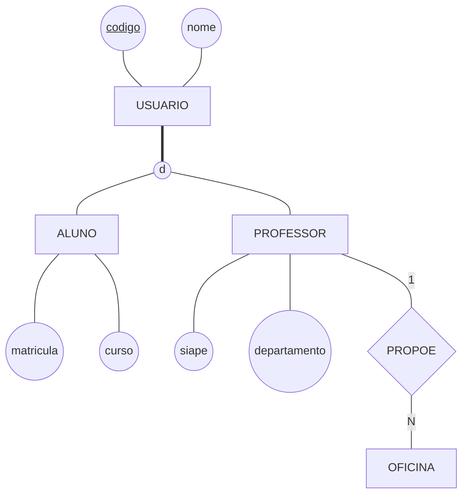

# Aula 09 — Especialização e o Esquema Completo

> 🎯 Objetivos: reconhecer quando uma entidade pede especialização e classificá-la nos dois eixos, e converter em tabelas os construtos que a Aula 07 deixou de fora — atributo composto, atributo multivalorado e especialização —, fechando o catálogo completo do DER ao esquema.
> 🎬 Slides da aula: [apresentacao-09-especializacao-e-o-esquema-completo.pdf](apresentacao/apresentacao-09-especializacao-e-o-esquema-completo.pdf)

O Bloco 2 terminou com o projeto inteiro da biblioteca, do minimundo ao esquema lógico. Este bloco leva esse esquema até um banco de dados de verdade, em quatro passos: hoje a conversão fica **completa**; na Aula 10, o esquema é **conferido** pela normalização; nas Aulas 11 e 12, ele vira um banco no **PostgreSQL** e responde às primeiras perguntas.

## 1. A entidade que não cabe em si mesma

A biblioteca atende alunos e professores, e alguém resolveu cadastrar todo mundo numa entidade só, `USUARIO`. Olhe o que aconteceu com a tabela:

```
   USUARIO
   ┌────────┬──────────────┬───────────┬──────────┬────────┬──────────────┐
   │ codigo │ nome         │ matricula │ curso    │ siape  │ departamento │
   ├────────┼──────────────┼───────────┼──────────┼────────┼──────────────┤
   │   101  │ Ana Souza    │ 2023101   │ ADS      │   —    │      —       │
   │   102  │ Bruno Lima   │ 2023102   │ Direito  │   —    │      —       │
   │   201  │ Carlos Mendes│     —     │    —     │ 104577 │ Computação   │
   │   202  │ Dora Alves   │     —     │    —     │ 118930 │ Letras       │
   └────────┴──────────────┴───────────┴──────────┴────────┴──────────────┘
```

**Metade da tabela é traço.** Aluno não tem SIAPE; professor não tem curso. E há uma regra que nenhuma coluna resolve: *"só professor propõe oficina"*. Com todo mundo na mesma entidade, o modelo não tem como dizer isso.

O sintoma tem nome: a entidade guarda **tipos diferentes de coisa**, com atributos e ligações diferentes. A saída é a **especialização**:

- **Especialização** é dividir uma entidade — a **superclasse** — em **subclasses** que **herdam** tudo o que ela tem e acrescentam o que é só delas;
- **Generalização** é o caminho inverso: reunir numa superclasse o que várias entidades já existentes têm em comum.

O desenho é o mesmo; muda o sentido em que você chegou nele — de cima para baixo, ou de baixo para cima.



**O que este diagrama afirma sobre o mundo.** Todo usuário tem código e nome. Todo usuário é aluno **ou** professor — a linha dupla até o círculo diz que não há terceira opção, e o `d` diz que ninguém é os dois. O aluno tem matrícula e curso; o professor tem SIAPE e departamento, e só ele propõe oficinas.

> ⚠️ **A subclasse herda — não repita.** `codigo` e `nome` estão em `USUARIO` e valem para aluno e professor. Desenhar `nome` de novo em `ALUNO` é afirmar que o aluno tem **dois** nomes.

> 💡 Quem faz o curso de Java já viu isto com outro nome: **herança**, escrita com `extends`. A diferença é que o banco relacional não tem `extends` — a seção 5 mostra o que se faz no lugar.

> 📖 O Heuser trata especialização e generalização junto com as construções avançadas do modelo ER, com a mesma notação de círculo entre a superclasse e as subclasses.

### ✏️ Tente você

A biblioteca cadastrou, separadas, duas entidades: `SALA_ESTUDO`, com número, andar, capacidade e se tem quadro branco; e `AUDITORIO`, com número, andar, capacidade, se tem projetor fixo e o tamanho do palco. Proponha uma **generalização**: qual é a superclasse, o que fica nela e o que fica em cada subclasse?

<details>
<summary>Resposta</summary>

A superclasse é **`ESPACO`**, com o que as duas têm em comum: `numero` (o identificador), `andar` e `capacidade`. Em `SALA_ESTUDO` fica só `quadro_branco`; em `AUDITORIO`, `projetor_fixo` e `tamanho_palco`.

O ganho aparece na primeira regra nova: *"todo espaço pode ser reservado"* passa a ser **um** relacionamento, com `ESPACO`, em vez de dois iguais.
</details>

## 2. As duas perguntas que toda especialização responde

Uma especialização nunca vem "solta": ela sempre responde a **duas perguntas independentes**, e o desenho precisa mostrar as duas respostas.

**Primeira — toda ocorrência da superclasse está em alguma subclasse?**

- **Total:** sim, obrigatoriamente. Desenha-se com **linha dupla** da superclasse até o círculo;
- **Parcial:** não — pode haver ocorrência que não é nenhuma das subclasses. **Linha simples**.

**Segunda — uma ocorrência pode estar em mais de uma subclasse ao mesmo tempo?**

- **Disjunta:** não. Escreve-se **`d`** dentro do círculo;
- **Sobreposta:** sim. Escreve-se **`o`** (de *overlapping*).

São quatro combinações, e você escolhe uma e **escreve qual**:

| | Disjunta (`d`) | Sobreposta (`o`) |
|---|---|---|
| **Total** (linha dupla) | todo usuário é exatamente um dos tipos | todo usuário é pelo menos um dos tipos |
| **Parcial** (linha simples) | pode não ser nenhum; se for, é um só | pode não ser nenhum, e pode ser vários |

Na biblioteca, as duas perguntas mudam de resposta com um detalhe do mundo. Se a biblioteca atende também a **comunidade externa** — gente que não é aluno nem professor —, a especialização é **parcial**. Se um professor pode fazer **mestrado** na própria instituição, ele é professor **e** aluno, e a especialização é **sobreposta**.

> ⚠️ **Diagrama que não diz qual das quatro é está incompleto.** A classificação parece detalhe e decide duas coisas na implantação: se o cadastro aceita um usuário sem tipo, e se aceita a mesma pessoa duas vezes. O erro clássico do [catálogo](../../recursos/erros-comuns.md) é tratar como disjunta o que é sobreposto — e o primeiro professor que se matricula no mestrado derruba o cadastro.

### ✏️ Tente você

Classifique cada especialização nos dois eixos, com uma linha de justificativa:

1. `ESPACO` em `SALA_ESTUDO` e `AUDITORIO`, sabendo que todo espaço da biblioteca é um ou outro;
2. `PESSOA` em `ALUNO` e `PROFESSOR`, numa faculdade em que professores podem cursar a pós-graduação, e em que há funcionários que não são nenhum dos dois;
3. `EXEMPLAR` em `EXEMPLAR_RARO`, com o valor do seguro e a sala-cofre onde fica — e só alguns exemplares são raros.

<details>
<summary>Resposta</summary>

1. **Total e disjunta.** Todo espaço é um dos dois, e nenhum é os dois;
2. **Parcial e sobreposta.** O funcionário não é nenhum (parcial), e o professor da pós é os dois (sobreposta);
3. **Parcial e disjunta.** A maioria dos exemplares não é rara (parcial); com uma subclasse só, a sobreposição nem é possível — disjunta por definição.

O item 3 mostra que especialização pode ter **uma subclasse só**: ela existe porque os raros têm atributos que os outros não têm.
</details>

## 3. Quando não especializar

A especialização é a construção mais usada em excesso do curso. Três testes recusam a maioria dos casos:

- **O teste do atributo próprio.** Se a subclasse não tem atributo nem relacionamento que as outras não tenham, ela não existe. `EXEMPLAR_DISPONIVEL` e `EXEMPLAR_EMPRESTADO`, cuja única diferença é estar ou não emprestado, são um **atributo** — `situacao` —, não duas subclasses;
- **O teste do tempo.** *"Isso pode mudar durante a vida do registro?"* Se pode, é **situação** ou **papel**, não tipo. `ALUNO` e `EX_ALUNO` como subclasses quebram no dia da formatura: o registro teria de mudar de classe, arrastando o histórico junto;
- **O teste do tamanho.** Uma subclasse com **um atributo próprio só**, e nada mais, raramente paga o custo de existir. Pergunte se o atributo não vive melhor como opcional na superclasse.

O par `ALUNO` / `PROFESSOR` passa nos três: cada um tem atributos próprios, ninguém vira professor de um dia para o outro por mudança de situação, e há ligação exclusiva — só professor propõe oficina.

> 💡 **Os três testes cabem numa pergunta:** a diferença entre os tipos é de **natureza** ou de **momento**? Natureza pede especialização. Momento pede atributo — ou um relacionamento com período, quando é preciso guardar a história.

### ✏️ Tente você

A coordenação pediu para separar `USUARIO` em `USUARIO_ADIMPLENTE` e `USUARIO_INADIMPLENTE`, porque *"o inadimplente não pode retirar livro"*. Aplique os três testes e diga o que você proporia no lugar.

<details>
<summary>Resposta</summary>

Falha nos **três**. Não há atributo próprio — os dois tipos têm exatamente os mesmos dados; a condição **muda com o tempo** — basta pagar a multa; e cada subclasse teria zero atributos, não um.

No lugar: um atributo `situacao` em `USUARIO`, ou, se for preciso saber desde quando, um registro das multas com data. A regra *"inadimplente não retira livro"* fica na lista de regras de negócio, em texto, e é verificada no balcão.
</details>

## 4. Atributo composto e multivalorado: o que a Aula 07 não converteu

A Aula 07 converteu entidades e relacionamentos. Faltaram dois tipos de atributo da Aula 03, e cada um tem a sua regra.

**Atributo composto: o todo some, ficam as partes.** O `endereco` da editora se divide em rua, número e cidade. No esquema, ele **não** vira coluna nem tabela: cada **parte** vira uma coluna.

```
   EDITORA(cnpj, nome, rua, numero, cidade)
```

**Atributo multivalorado: vira tabela.** Uma editora tem **vários** telefones. Uma coluna guarda um valor só, então o telefone ganha uma tabela própria, com a chave da dona e o valor — e os dois **juntos** são a chave primária:

```
   EDITORA(cnpj, nome, rua, numero, cidade)
   EDITORA_TELEFONE(cnpj → EDITORA, telefone)
                    └─── chave primária composta ───┘
```

Repare que a regra é a mesma da entidade fraca da Aula 07: o telefone não existe sem a editora, e só se distingue dentro dela.

> ⚠️ **`telefone1`, `telefone2`, `telefone3` não resolvem.** É o erro do [catálogo](../../recursos/erros-comuns.md): a editora com quatro telefones não cabe, a editora com um desperdiça duas colunas, e procurar um número exige olhar em três lugares. Multivalorado vira tabela. **Sempre.** Na Aula 10, essa mesma regra vai ganhar um nome: primeira forma normal.

### ✏️ Tente você

Converta o `AUTOR` da biblioteca, agora com mais detalhes: CPF (identificador), **nome completo** dividido em nome e sobrenome, **e-mails** — um autor pode ter vários — e **nacionalidade**.

<details>
<summary>Resposta</summary>

```
   AUTOR(cpf, nome, sobrenome, nacionalidade)
   AUTOR_EMAIL(cpf → AUTOR, email)
```

O nome completo é **composto**: virou duas colunas, e a palavra "nome_completo" sumiu do esquema. Os e-mails são **multivalorados**: viraram tabela, com chave `(cpf, email)`. A nacionalidade é simples e fica onde está.
</details>

## 5. A especialização vira tabela

O banco relacional não tem herança. Para converter uma especialização existem **três estratégias**, e quem decide entre elas são as duas perguntas da seção 2.

**Estratégia A — uma tabela para a hierarquia inteira.** Tudo numa tabela, com uma coluna dizendo o tipo:

```
   USUARIO(codigo, nome, tipo, matricula, curso, siape, departamento)
```

É a mais simples, e é a planilha da seção 1 de volta: metade das colunas vazias em cada linha, e nada impede um "professor" com curso preenchido.

**Estratégia B — uma tabela para a superclasse e uma para cada subclasse.** Cada subclasse tem só os atributos dela, e a **chave primária de cada subclasse é também chave estrangeira** para a superclasse:

```
   USUARIO(codigo, nome)
   ALUNO(codigo → USUARIO, matricula, curso)
   PROFESSOR(codigo → USUARIO, siape, departamento)
```

Nenhuma coluna vazia por desenho, e ela serve para **as quatro combinações**: o usuário que não é nenhum dos dois fica só em `USUARIO` (parcial), e o professor do mestrado aparece em `ALUNO` **e** em `PROFESSOR` com o mesmo código (sobreposta). É a escolha padrão.

**Estratégia C — só as subclasses.** A superclasse desaparece, e os atributos dela se repetem em cada subclasse:

```
   ALUNO(codigo, nome, matricula, curso)
   PROFESSOR(codigo, nome, siape, departamento)
```

Só funciona quando a especialização é **total e disjunta**. Se for parcial, o usuário que não é nenhum dos dois não tem onde ficar; se for sobreposta, o professor do mestrado tem o nome escrito **duas vezes** — a redundância da Aula 01 de volta.

| Estratégia | Serve para | O custo |
|---|---|---|
| **A** — uma tabela só | qualquer caso, quando as subclasses quase não têm atributos próprios | colunas vazias, e o banco não garante as regras de cada tipo |
| **B** — superclasse + subclasses | **qualquer combinação** dos dois eixos | uma junção a mais para montar o registro inteiro |
| **C** — só as subclasses | apenas **total e disjunta** | perde-se o lugar comum: a ligação com "todo usuário" precisa ser feita duas vezes |

> 💡 Na estratégia B, a chave da hierarquia é a da superclasse. A `matricula` e o `siape` continuam únicos — viram **chaves alternativas**, como na Aula 07.

### ✏️ Tente você

Para o `ESPACO` do primeiro Tente você — total e disjunta —, quais das três estratégias são possíveis? Escreva o esquema na que você escolheria, e diga por quê.

<details>
<summary>Resposta</summary>

As **três** são possíveis, porque total e disjunta é o único caso que aceita a C.

A escolha que se defende melhor é a **B**:

```
   ESPACO(numero, andar, capacidade)
   SALA_ESTUDO(numero → ESPACO, quadro_branco)
   AUDITORIO(numero → ESPACO, projetor_fixo, tamanho_palco)
```

A razão é a regra que motivou a generalização: *"todo espaço pode ser reservado"*. Com `ESPACO` existindo como tabela, a reserva aponta para **um** lugar só. Na C, ela precisaria de duas ligações — uma para sala, outra para auditório.
</details>

## 6. O catálogo completo: do DER ao esquema

Com esta aula, todo construto do DER tem uma regra de conversão. O catálogo inteiro, numa tabela:

| No DER | No esquema | Aula |
|---|---|:---:|
| entidade | tabela; o identificador vira chave primária | 07 |
| atributo simples | coluna | 07 |
| atributo **composto** | uma coluna para cada parte | **09** |
| atributo **multivalorado** | tabela própria: chave da dona + valor | **09** |
| atributo derivado | **nenhuma coluna** — é calculado | 03 |
| relacionamento **1:N** | chave estrangeira no lado N | 07 |
| relacionamento **1:1** | chave estrangeira num dos lados — o de participação total | 07 |
| relacionamento **N:M** | tabela associativa; as duas chaves formam a primária; os atributos do losango vão nela | 07 |
| entidade **fraca** | chave da dona + o discriminador, juntos | 07 |
| **autorrelacionamento** | chave estrangeira para a própria tabela, com o nome do papel | 07 |
| **agregação** | tabela associativa; quem se liga a ela aponta para a chave dela | 08 |
| **especialização** | superclasse + uma tabela por subclasse (ou as estratégias A e C, conforme os eixos) | **09** |

O esquema da biblioteca, com tudo o que o curso acrescentou até aqui:

```
   USUARIO(codigo, nome, email)
   ALUNO(codigo → USUARIO, matricula, curso)
   PROFESSOR(codigo → USUARIO, siape, departamento)
   EDITORA(cnpj, nome, rua, numero, cidade)
   EDITORA_TELEFONE(cnpj → EDITORA, telefone)
   AUTOR(cpf, nome, sobrenome, nacionalidade)
   LIVRO(isbn, titulo, ano, cnpj → EDITORA)
   ESCREVE(cpf → AUTOR, isbn → LIVRO, ordem)
   EXEMPLAR(isbn → LIVRO, numero_ex, situacao)
   EMPRESTIMO(numero, data_retirada, data_devolucao,
              codigo_usuario → USUARIO,
              isbn + numero_ex → EXEMPLAR)
   OFICINA(codigo, tema, data, codigo_professor → PROFESSOR)
```

Repare em duas mudanças em relação à Aula 08. O empréstimo agora aponta para **`USUARIO`**, e não para `ALUNO`: professores também retiram livros, e é a superclasse que representa "todo mundo que retira". Já a oficina aponta para **`PROFESSOR`**: a regra *"só professor propõe oficina"*, que na seção 1 não tinha onde morar, virou uma chave estrangeira.

> 💡 **Este é o esquema que vai até o fim do curso.** Na Aula 10 ele passa pela normalização; nas Aulas 11 e 12, vira um banco no PostgreSQL. Cada tabela daqui vai ter um comando para ser criada.

> 💻 **Modelos desta aula:** [`convertendo-tudo.md`](exemplos/convertendo-tudo.md) — **um DER com especialização, atributo composto, atributo multivalorado e agregação, convertido do começo ao fim**, passo a passo. Continua o caso das oficinas das Aulas 07 e 08; leia antes dos exercícios.

## 🏋️ Exercícios da aula

Use o **modelo entidade-relacionamento** para o projeto conceitual das bases de dados abaixo. Em todos os exercícios:

- para cada **entidade**, especifique os atributos relevantes — simples, compostos ou multivalorados — incluindo o **atributo identificador**;
- para cada **relacionamento**, dê a **cardinalidade** dos dois lados, diga se a **participação** de cada entidade é total ou parcial e inclua os atributos do relacionamento, se houver;
- nas **especializações**, diga se ela é **total ou parcial** e **disjunta ou sobreposta**, com uma linha de justificativa para cada eixo;
- entregue também o **esquema lógico**, marcando as chaves primárias e indicando com `→` cada chave estrangeira e a tabela que ela aponta.

Cada enunciado diz **o que se deseja registrar**. Ele não diz o que é entidade, o que é atributo, o que é relacionamento e o que é especialização — essa decisão é sua, e é o exercício.

> 💡 O percurso inteiro de uma conversão como estas está em [`convertendo-tudo.md`](exemplos/convertendo-tudo.md). Leia antes de começar.

Na pasta `aula-09/` do seu repositório, um arquivo `.md` por exercício:

1. **`ex01.md`** — O acervo da biblioteca deixou de ser só de livros. Todo **item do acervo** tem um código de tombo, único, o título e o ano. Os **livros** têm ainda ISBN e edição; os **periódicos**, ISSN e periodicidade — mensal, trimestral; as **mídias**, o tipo — DVD, CD — e a duração em minutos. Todo item é exatamente um desses três tipos. Os empréstimos continuam valendo para qualquer item.

   *Confere assim: a especialização é total e disjunta — e, como o empréstimo vale para **qualquer** item, a sua escolha de estratégia precisa deixar um lugar só para o empréstimo apontar. Se você escolheu a estratégia C, conte quantas chaves estrangeiras o empréstimo ganhou. E o ISBN, o ISSN e o código de tombo são todos únicos, mas só um deles é a chave da hierarquia.*

2. **`ex02.md`** — A biblioteca vai cadastrar os seus **funcionários**. De cada um guardam-se a matrícula funcional, o nome, o **endereço** — rua, número, bairro e cidade —, **um ou mais telefones** e os **idiomas** que ele fala, para o atendimento a estrangeiros — há funcionários que só falam português, e então não se registra idioma nenhum.

   *Confere assim: o endereço vira quatro colunas, e não uma tabela; o telefone e o idioma viram **uma tabela cada um**, e as duas têm chave primária composta. Se apareceu `telefone1` ou `idioma2` no seu esquema, releia o ⚠️ da seção 4.*

3. **`ex03.md`** — Converta para esquema lógico o DER abaixo, das **pessoas** que frequentam os eventos da biblioteca. Toda pessoa tem CPF e nome; quem é **palestrante** tem também um minicurrículo, e quem é **participante** tem o e-mail para receber o certificado. Uma pessoa pode ser as duas coisas, e há pessoas cadastradas — os organizadores — que não são nenhuma.

   ```mermaid
   flowchart TB
       cpf(("<u>cpf</u>")) --- PESSOA[PESSOA]
       nome((nome)) --- PESSOA
       PESSOA --- O(("o"))
       O --- PAL[PALESTRANTE]
       O --- PAR[PARTICIPANTE]
       PAL --- cv((minicurriculo))
       PAR --- email((email))
       PAL ---|N| APRES{APRESENTA}
       APRES ---|M| EVT[EVENTO]
       APRES --- hor((horario))
       EVT --- cod(("<u>codigo</u>"))
       EVT --- temas(((temas)))
   ```

   *Confere assim: a especialização é parcial e sobreposta, e só uma das três estratégias da seção 5 serve — se você escolheu outra, a pessoa que é palestrante e participante ficou com o nome escrito duas vezes, ou o organizador não coube em lugar nenhum. Saem seis tabelas, e o `temas` não está entre as colunas de `EVENTO`.*

### 📤 Entrega

Estes exercícios são feitos em sala e vão para o **seu repositório** `exercicios-modelagem-dados`:

```bash
cd ..                 # da pasta da aula para a raiz do repositório
git add aula-09/
git commit -m "Resolve exercícios da aula 09"
git push
```

Confira no navegador que a pasta apareceu em `github.com/SEU-USUARIO/exercicios-modelagem-dados`.

## 🧠 Revisão

[8 questões de múltipla escolha](revisao/README.md) para conferir se os conceitos ficaram sólidos. Responda sem consultar a aula — depois volte e corrija.

---

⬅️ [Aula 08 — Agregação e Estudo de Caso](../../bloco-2-modelos-de-banco-de-dados/aula-08-agregacao-e-estudo-de-caso/README.md) | ➡️ [Aula 10 — Normalização Essencial](../aula-10-normalizacao-essencial/README.md)
