<!-- _class: capa -->

<div class="emoji">🌳</div>

# Especialização e o Esquema Completo

## Aula 09 · Bloco 3 — Do Modelo ao Banco

<div class="meta">Metade da tabela é traço — e isso é um sintoma</div>

---

## 🎯 Nesta aula

1. A entidade que **não cabe em si mesma**
2. As **duas perguntas** que toda especialização responde
3. Quando **não** especializar
4. Atributo **composto** e **multivalorado**: o que a Aula 07 não converteu
5. A **especialização vira tabela** — três estratégias
6. O **catálogo completo**, do DER ao esquema

---

<!-- _class: diagrama -->

## O Bloco 3: do modelo ao banco


O Bloco 2 terminou com o esquema lógico da biblioteca. Este bloco leva esse esquema até um **banco de dados de verdade** — e hoje a conversão fica completa.

---

## Metade da tabela é traço

| codigo | nome | matricula | curso | siape | departamento |
|:---:|---|:---:|---|:---:|---|
| 101 | Ana Souza | 2023101 | ADS | — | — |
| 102 | Bruno Lima | 2023102 | Direito | — | — |
| 201 | Carlos Mendes | — | — | 104577 | Computação |
| 202 | Dora Alves | — | — | 118930 | Letras |

Aluno não tem SIAPE; professor não tem curso. E a regra *"só professor propõe oficina"* não tem onde morar.

**A entidade guarda tipos diferentes de coisa.**

---

## Especialização e generalização

**Especialização** é dividir uma entidade — a **superclasse** — em **subclasses** que **herdam** tudo o que ela tem e acrescentam o que é só delas.

**Generalização** é o caminho inverso: reunir numa superclasse o que várias entidades já existentes têm em comum.

O desenho é o mesmo; muda o sentido em que você chegou nele — **de cima para baixo**, ou **de baixo para cima**.

> 📖 O Heuser trata as duas junto com as construções avançadas do modelo ER.

---

<!-- _class: diagrama -->

## O desenho, em Chen



**Linha dupla** até o círculo: todo usuário é de algum tipo. **`d`**: ninguém é os dois. E só `PROFESSOR` propõe oficina — a regra ganhou lugar.

---

## ⚠️ A subclasse herda — não repita

`codigo` e `nome` estão em `USUARIO` e valem para aluno e professor.

Desenhar `nome` de novo em `ALUNO` é afirmar que o aluno tem **dois** nomes.

> 💡 Quem faz o curso de Java já viu isto com outro nome: **herança**, escrita com `extends`. O banco relacional **não tem `extends`** — a seção 5 mostra o que se faz no lugar.

---

<!-- _class: diagrama -->

## Generalização: de baixo para cima



Sala de estudo e auditório têm número, andar e capacidade em comum: isso sobe para `ESPACO`. O ganho aparece na regra *"todo espaço pode ser reservado"* — **uma** ligação, e não duas iguais.

---

## As duas perguntas que toda especialização responde

**1. Toda ocorrência da superclasse está em alguma subclasse?**

- **Total** — sim, obrigatoriamente: **linha dupla** até o círculo;
- **Parcial** — não, pode não ser nenhuma: **linha simples**.

**2. Uma ocorrência pode estar em mais de uma subclasse ao mesmo tempo?**

- **Disjunta** — não: **`d`** no círculo;
- **Sobreposta** — sim: **`o`** no círculo.

As duas são **independentes**: uma não diz nada sobre a outra.

---

## Quatro combinações — escolha uma e escreva qual

| | Disjunta (`d`) | Sobreposta (`o`) |
|---|---|---|
| **Total** — linha dupla | todo usuário é **exatamente um** dos tipos | todo usuário é **pelo menos um** dos tipos |
| **Parcial** — linha simples | pode não ser nenhum; se for, é **um só** | pode não ser nenhum, e pode ser **vários** |

> ⚠️ **Diagrama que não diz qual das quatro é está incompleto.** A classificação decide se o cadastro aceita usuário sem tipo — e se aceita a mesma pessoa duas vezes.

---

<!-- _class: diagrama -->

## Um detalhe do mundo muda a resposta



Se há **funcionários** que não são aluno nem professor, é **parcial**. Se um professor pode fazer **mestrado**, ele é os dois: **sobreposta**. O erro clássico do catálogo é tratar como disjunta o que é sobreposto.

---

## Quando não especializar: três testes

- **O atributo próprio.** Se a subclasse não tem atributo nem ligação que as outras não tenham, ela não existe. `EXEMPLAR_DISPONIVEL` e `EXEMPLAR_EMPRESTADO` são um **atributo** `situacao`;
- **O tempo.** *"Isso pode mudar durante a vida do registro?"* Se pode, é **situação**, não tipo. `ALUNO` e `EX_ALUNO` quebram no dia da formatura;
- **O tamanho.** Uma subclasse com **um** atributo próprio só raramente paga o custo de existir.

O par `ALUNO` / `PROFESSOR` passa nos três.

---

<!-- _class: lead -->

## 💡 Natureza ou momento?

A diferença entre os tipos é de **natureza** —
ou de **momento**?

Natureza pede **especialização**.
Momento pede **atributo**.

*"Usuário adimplente e inadimplente"*
falha nos três testes de uma vez:
basta pagar a multa para mudar de "tipo".

---

<!-- _class: diagrama -->

## Atributo composto: o todo some, ficam as partes



O `endereco` não vira coluna nem tabela: **cada parte vira uma coluna**. A editora tem **um** endereço — com partes.

---

<!-- _class: diagrama -->

## Atributo multivalorado: vira tabela



Uma coluna guarda um valor só. O telefone ganha **tabela própria**, com a chave da dona e o valor, juntos como chave primária — a mesma regra da **entidade fraca** da Aula 07.

---

## ⚠️ `telefone1`, `telefone2`, `telefone3` não resolvem

É o erro do catálogo, e ele cria três problemas de uma vez:

- a editora com **quatro** telefones não cabe;
- a editora com **um** desperdiça duas colunas;
- procurar um número exige olhar em **três** lugares.

**Multivalorado vira tabela. Sempre.**

Na **Aula 10**, essa mesma regra vai ganhar um nome: **primeira forma normal**.

---

<!-- _class: lead -->

## O banco relacional não tem herança

Para converter uma especialização
existem **três estratégias** —
e quem decide entre elas são
**as duas perguntas** da seção 2.

---

## Estratégia A — uma tabela para a hierarquia

```
   USUARIO(codigo, nome, tipo, matricula, curso, siape, departamento)
```

Tudo numa tabela, com uma coluna dizendo o tipo.

É a mais simples — e é **a planilha do começo da aula de volta**: metade das colunas vazias em cada linha, e nada impede um "professor" com curso preenchido.

---

<!-- _class: diagrama -->

## Estratégia B — superclasse e uma tabela por subclasse



**A chave de cada subclasse é também chave estrangeira** para a superclasse. Nenhuma coluna vazia por desenho, e serve para **as quatro combinações** — é a escolha padrão.

---

## Estratégia C — só as subclasses

```
   ALUNO(codigo, nome, matricula, curso)
   PROFESSOR(codigo, nome, siape, departamento)
```

A superclasse desaparece, e os atributos dela se repetem em cada subclasse. **Só funciona quando é total e disjunta**:

- se for **parcial**, quem não é nenhum dos tipos não tem onde ficar;
- se for **sobreposta**, o professor do mestrado tem o nome escrito **duas vezes** — a redundância da Aula 01 de volta.

---

<!-- _class: tabela-densa -->

## As três, lado a lado

| Estratégia | Serve para | O custo |
|---|---|---|
| **A** — uma tabela só | subclasses quase sem atributos próprios | colunas vazias; o banco não garante as regras de cada tipo |
| **B** — superclasse + subclasses | **qualquer combinação** dos dois eixos | uma junção a mais para montar o registro inteiro |
| **C** — só as subclasses | apenas **total e disjunta** | perde o lugar comum: a ligação com "todo usuário" é feita duas vezes |

> 💡 Na B, a chave da hierarquia é a da superclasse. `matricula` e `siape` continuam únicas — viram **chaves alternativas**, como na Aula 07.

---

<!-- _class: tabela-densa -->

## O catálogo completo — o que a Aula 07 já convertia

| No DER | No esquema |
|---|---|
| entidade | tabela; o identificador vira chave primária |
| relacionamento **1:N** | chave estrangeira no lado N |
| relacionamento **1:1** | chave estrangeira no lado de participação total |
| relacionamento **N:M** | tabela associativa; as duas chaves formam a primária |
| entidade **fraca** | chave da dona + o discriminador |
| **autorrelacionamento** | chave estrangeira para a própria tabela, com o nome do papel |

---

<!-- _class: tabela-densa -->

## O catálogo completo — o que faltava

| No DER | No esquema | Aula |
|---|---|:---:|
| atributo **composto** | uma coluna para cada parte | 09 |
| atributo **multivalorado** | tabela própria: chave da dona + valor | 09 |
| atributo **derivado** | nenhuma coluna — é calculado | 03 |
| **agregação** | tabela associativa; quem se liga a ela aponta para a chave dela | 08 |
| **especialização** | superclasse + uma tabela por subclasse — ou A e C, conforme os eixos | 09 |

**Agora todo construto do DER tem uma regra de conversão.**

---

## O esquema completo da biblioteca

```
   USUARIO(codigo, nome, email)
   ALUNO(codigo → USUARIO, matricula, curso)
   PROFESSOR(codigo → USUARIO, siape, departamento)
   EDITORA(cnpj, nome, rua, numero, cidade)
   EDITORA_TELEFONE(cnpj → EDITORA, telefone)
   AUTOR(cpf, nome, sobrenome, nacionalidade)
   LIVRO(isbn, titulo, ano, cnpj → EDITORA)
   ESCREVE(cpf → AUTOR, isbn → LIVRO, ordem)
   EXEMPLAR(isbn → LIVRO, numero_ex, situacao)
   EMPRESTIMO(numero, data_retirada, data_devolucao,
              codigo_usuario → USUARIO, isbn + numero_ex → EXEMPLAR)
   OFICINA(codigo, tema, data, codigo_professor → PROFESSOR)
```

---

## Duas mudanças desde a Aula 08

- **O empréstimo aponta para `USUARIO`**, e não para `ALUNO`: professores também retiram livros, e é a superclasse que representa "todo mundo que retira";
- **A oficina aponta para `PROFESSOR`**: a regra *"só professor propõe oficina"*, que não tinha onde morar, **virou uma chave estrangeira**.

> 💡 **Este é o esquema que vai até o fim do curso.** Na Aula 10 ele passa pela normalização; nas Aulas 11 e 12, vira um banco no **PostgreSQL** — e cada tabela daqui vai ter um comando para ser criada.

---

<!-- _class: checkpoint -->

## 🏋️ Exercícios da aula

Na pasta `aula-09/`:

1. **`ex01.md`** — livros, periódicos e mídias: a especialização dos **itens do acervo**, e a estratégia;
2. **`ex02.md`** — os **funcionários**: endereço, telefones e idiomas, no esquema;
3. **`ex03.md`** — converta o DER das **pessoas dos eventos**: parcial e sobreposta.

---

<!-- _class: lead -->

## ➡️ Próxima aula

**Aula 10 — Normalização essencial**

O esquema está completo.
Mas está **certo**?
A normalização é a régua que **prova** —
em vez de discutir gosto.
