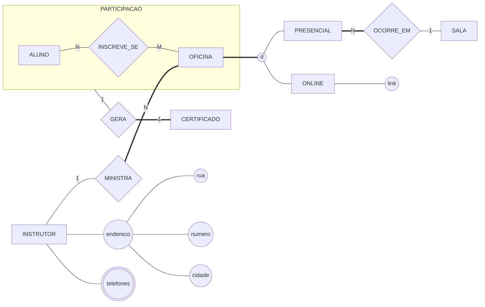

# Convertendo tudo — as oficinas, com especialização

Este arquivo mostra **o percurso da conversão completa**: um DER que usa **todos** os construtos novos desta aula — atributo composto, atributo multivalorado e especialização — e ainda a agregação da Aula 08, convertido passo a passo, com o motivo de cada tabela escrito ao lado.

É o mesmo caso das oficinas de pesquisa que a Aula 07 converteu em [`convertendo-um-der.md`](../../../bloco-2-modelos-de-banco-de-dados/aula-07-relacional-e-integridade/exemplos/convertendo-um-der.md), agora maior.

---

## O ponto de partida

A secretaria trouxe três novidades:

- as oficinas passaram a ser **presenciais** — numa sala — ou **on-line** — com o link e a plataforma —, e toda oficina é exatamente uma das duas;
- cada oficina é ministrada por um **instrutor**, de quem se guardam o CPF, o nome, o **endereço** — rua, número e cidade — e **um ou mais telefones**;
- quem conclui uma oficina recebe um **certificado** daquela participação, com número e data de emissão — o caso do `ex01` da Aula 08.



Lendo o desenho: a especialização de `OFICINA` é **total e disjunta** (linha dupla e `d`); só a oficina **presencial** ocorre numa sala; o `endereco` tem três elipses penduradas, então é **composto**; `telefones` tem contorno duplo, então é **multivalorado**; e o certificado sai **da caixa** da participação, como manda a agregação.

Cinco passos, um por construto.

## Passo 1 — as entidades e os atributos simples

Uma entidade, uma tabela; o identificador vira a chave primária.

```
   ALUNO(matricula, nome)
   SALA(numero, andar, capacidade)
   INSTRUTOR(cpf, nome)
```

`OFICINA` e o `CERTIFICADO` ficam para os passos 4 e 5, porque dependem de decisões que ainda não foram tomadas.

## Passo 2 — o atributo composto vira colunas

O `endereco` some; ficam as partes.

```
   INSTRUTOR(cpf, nome, rua, numero, cidade)
```

> ⚠️ Não crie uma tabela `ENDERECO` só porque o atributo é composto. Composto é **um valor com partes**, e o instrutor tem **um** endereço. Tabela seria a resposta se fossem vários — aí ele seria multivalorado.

## Passo 3 — o atributo multivalorado vira tabela

Um instrutor tem vários telefones, e uma coluna guarda um valor só. Nasce uma tabela com a chave da dona e o valor:

```
   INSTRUTOR_TELEFONE(cpf → INSTRUTOR, telefone)
                      └─ chave primária composta ─┘
```

A chave é o **par**: o mesmo número não se repete para o mesmo instrutor, e dois instrutores podem dividir o telefone da recepção.

## Passo 4 — a especialização: estratégia B

Total e disjunta aceita qualquer das três estratégias da seção 5. A decisão vem do **resto do desenho**: o `INSCREVE_SE` e o `MINISTRA` ligam-se a **toda** oficina, presencial ou on-line. Com a superclasse existindo como tabela, essas ligações apontam para um lugar só — é a estratégia **B**.

```
   OFICINA(codigo, tema, data, cpf_instrutor → INSTRUTOR)
   PRESENCIAL(codigo → OFICINA, numero_sala → SALA)
   ONLINE(codigo → OFICINA, link, plataforma)
```

Repare no `numero_sala`. O relacionamento `OCORRE_EM` é só da oficina **presencial**, então a chave estrangeira mora na **subclasse**, e não em `OFICINA`. Na estratégia A, ela estaria vazia em todas as linhas on-line — é exatamente o que a especialização existe para evitar. E o `cpf_instrutor` foi para `OFICINA` pela regra do 1:N da Aula 07: lado N.

> 💡 A estratégia C teria criado `PRESENCIAL(codigo, tema, data, cpf_instrutor, numero_sala)` e `ONLINE(codigo, tema, data, cpf_instrutor, link, plataforma)`. Funciona, mas a inscrição do aluno precisaria de **duas** chaves estrangeiras — uma para cada tipo de oficina —, e nada impediria a mesma inscrição apontar para as duas.

## Passo 5 — a agregação e o que se liga a ela

A participação é um N:M, então vira tabela associativa; o certificado se liga **a ela**, com uma chave estrangeira de duas colunas — a lição da Aula 08:

```
   INSCRICAO(matricula → ALUNO, codigo_oficina → OFICINA, data_inscricao)
   CERTIFICADO(numero, data_emissao,
               matricula + codigo_oficina → INSCRICAO)
```

O certificado é 1:1 com a participação, com participação total do lado do certificado: por isso a chave estrangeira mora nele e **não aceita vazio**. E as duas colunas dela formam uma chave **alternativa** — um certificado por participação.

## O esquema completo

```
   ALUNO(matricula, nome)
   SALA(numero, andar, capacidade)
   INSTRUTOR(cpf, nome, rua, numero, cidade)
   INSTRUTOR_TELEFONE(cpf → INSTRUTOR, telefone)
   OFICINA(codigo, tema, data, cpf_instrutor → INSTRUTOR)
   PRESENCIAL(codigo → OFICINA, numero_sala → SALA)
   ONLINE(codigo → OFICINA, link, plataforma)
   INSCRICAO(matricula → ALUNO, codigo_oficina → OFICINA, data_inscricao)
   CERTIFICADO(numero, data_emissao,
               matricula + codigo_oficina → INSCRICAO)
```

Nove tabelas. A conferência que vale para qualquer conversão: **cada construto do desenho tem de estar numa linha do esquema**.

| No desenho | No esquema |
|---|---|
| o `endereco` composto | três colunas em `INSTRUTOR` |
| os `telefones` multivalorados | a tabela `INSTRUTOR_TELEFONE` |
| a especialização total e disjunta | `OFICINA` + `PRESENCIAL` + `ONLINE` |
| o `OCORRE_EM`, só da presencial | `numero_sala` em `PRESENCIAL`, e não em `OFICINA` |
| o `MINISTRA` 1:N | `cpf_instrutor` em `OFICINA` |
| a agregação e o certificado | `INSCRICAO`, e a chave de duas colunas em `CERTIFICADO` |

## O que não coube no esquema

Duas regras não viraram tabela nem coluna, e ficam na lista em texto:

- **a oficina on-line não pode ter sala** — na estratégia B isso já é garantido pela estrutura, porque `ONLINE` não tem coluna de sala; mas o banco **não impede** que o mesmo código apareça em `PRESENCIAL` e em `ONLINE` ao mesmo tempo. A disjunção fica para a aplicação;
- **só recebe certificado quem concluiu** — "concluir" é um fato que o modelo não registra. Ou se acrescenta uma coluna `concluiu` em `INSCRICAO`, ou a regra vive na lista.

Um modelo continua sendo **o esquema mais a lista** — e a lista é o que sobra quando a notação não alcança.

---

⬅️ [Voltar à Aula 09](../README.md)
