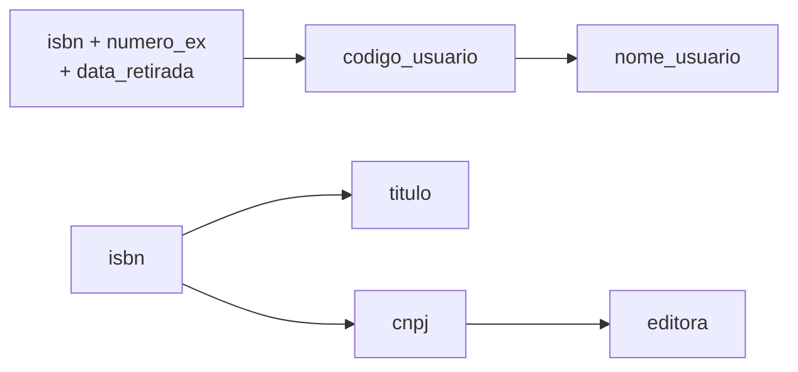

# Aula 10 — Normalização Essencial

> 🎯 Objetivos: reconhecer a redundância que sobrevive numa tabela, escrever as dependências funcionais a partir das regras do minimundo e levar a tabela até a 3FN em três passos, conferindo que nenhuma informação se perdeu.
> 🎬 Slides da aula: [apresentacao-10-normalizacao-essencial.pdf](apresentacao/apresentacao-10-normalizacao-essencial.pdf)

A Aula 09 fechou o esquema da biblioteca, construto por construto. Fica uma pergunta: **como saber que ele está certo?** O DER foi desenhado com cuidado, mas cuidado não é garantia.

A conferência tem regra escrita, e se chama **normalização**. Ela não substitui o DER: confere o que ele produziu e pega o que escapou. Esta aula faz o caminho essencial em um encontro — da tabela problemática à terceira forma normal. As leituras complementares de normalização refazem o mesmo caminho com mais calma e vão até a 4FN.

## 1. A planilha volta, disfarçada de tabela

Antes do sistema, o balcão controlava as retiradas numa planilha. Na migração, alguém importou a planilha do jeito que estava, como uma tabela só:

| isbn | numero_ex | data_retirada | titulo | autores | cnpj | editora | codigo_usuario | nome_usuario |
|---|:---:|---|---|---|---|---|:---:|---|
| …017 | 1 | 05/10 | Introdução aos Bancos de Dados | Marta Ribeiro, João Pereira | …0101 | Editora Aurora | 1 | Ana Souza |
| …017 | 1 | 20/10 | Introdução aos Bancos de Dados | Marta Ribeiro, João Pereira | …0101 | Editora Aurora | 1 | Ana Souza |
| …031 | 1 | 03/11 | SQL para Iniciantes | Lucía Fernández | …0102 | Editora Vértice | 2 | Bruno Lima |
| …031 | 2 | 05/11 | SQL para Iniciantes | Lucía Fernández | …0102 | Editora Vértice | 4 | Carlos Mendes |

A chave é o trio `(isbn, numero_ex, data_retirada)`: o mesmo exemplar sai muitas vezes, mas não duas no mesmo dia.

Repare quantas vezes o mesmo fato está escrito. O título de cada livro aparece em toda retirada dele; o nome da editora, em toda retirada de todo livro dela; o nome da Ana, em toda retirada da Ana. São as **três anomalias da Aula 01**, de volta:

- **Alteração:** a editora mudou de nome? É preciso corrigir todas as linhas de todos os livros dela — e a linha esquecida contradiz as outras;
- **Inserção:** chegou um livro novo, ainda sem nenhuma retirada? Ele **não cabe**: a chave exige uma data de retirada, e ela não existe;
- **Exclusão:** apagou a única retirada de um livro? O livro some junto, com o título e a editora.

> ⚠️ **Isto acontece mesmo em projeto com DER.** A planilha importada, o relatório que virou tabela "para ser mais rápido", a conversão da ferramenta que ninguém revisou — os três caminhos produzem tabelas assim, e o DER não estava errado em nenhum deles.

A **normalização** é o processo, proposto por Codd no começo dos anos 1970, de **decompor uma tabela em tabelas menores, seguindo regras chamadas formas normais, até que cada fato fique registrado num lugar só**.

> 💡 **Normalizar não inventa nada: só separa.** Nenhuma coluna nova aparece, nenhum dado se perde. O que muda é onde cada fato mora.

## 2. Dependência funcional: "se eu sei isto, eu sei aquilo"

A ferramenta da normalização é uma pergunta simples: **se eu sei o valor desta coluna, eu sei o valor daquela?**

Se eu sei o ISBN, eu sei o título — um ISBN identifica um livro só. Isso se escreve **`isbn → titulo`** e se lê *"isbn determina titulo"*. É uma **dependência funcional**: para cada valor do lado esquerdo, existe **um único** valor do lado direito.

As dependências da tabela de retiradas:



| Dependência | De onde ela vem — a regra do minimundo |
|---|---|
| `(isbn, numero_ex, data_retirada) → codigo_usuario` | cada retirada é de um usuário só |
| `codigo_usuario → nome_usuario` | cada usuário tem um nome |
| `isbn → titulo` | cada livro tem um título |
| `isbn → cnpj` | cada livro tem uma editora (RN-01) |
| `cnpj → editora` | cada CNPJ é de uma editora |

E duas que **não** valem: `titulo → isbn` (dois livros diferentes podem ter o mesmo título) e `isbn → autores`, porque um livro tem **vários** autores — e é isso que a seção 3 resolve.

> ⚠️ **A dependência vem da regra, nunca dos dados.** Olhando as quatro linhas acima, parece que `nome_usuario → codigo_usuario` — não há dois usuários com o mesmo nome. É coincidência da amostra: a biblioteca pode ter duas Anas Souza amanhã. Quatro linhas, ou quatro mil, nunca **provam** uma dependência; só podem mostrar que ela **não** existe. Quem decide é o mundo, e o mundo se descobre perguntando, como na Aula 04.

> 📖 O Date trata dependência funcional com rigor, no capítulo de normalização; a leitura complementar [Dependência funcional, 1FN e 2FN](../../leituras-complementares/dependencia-funcional-1fn-2fn/README.md) faz o mesmo caminho com outro caso.

### ✏️ Tente você

A secretaria descreve as oficinas assim: *"cada oficina tem um código e um tema, e é ministrada por um instrutor; cada instrutor tem um CPF e um nome; a mesma pessoa pode ministrar várias oficinas, e duas oficinas podem ter o mesmo tema."* Quais destas dependências valem?

1. `codigo → tema`
2. `tema → codigo`
3. `codigo → cpf_instrutor`
4. `cpf_instrutor → nome_instrutor`
5. `cpf_instrutor → codigo`

<details>
<summary>Resposta</summary>

Valem a **1**, a **3** e a **4**. A **2** não vale porque duas oficinas podem ter o mesmo tema — a regra diz isso com todas as letras. A **5** não vale porque o mesmo instrutor ministra várias oficinas: saber o CPF não diz **qual** oficina.

Repare que todas as respostas saíram da frase da secretaria, e nenhuma de uma tabela com dados.
</details>

## 3. A primeira forma normal: cada célula, um valor

**Uma tabela está na 1FN quando toda célula guarda um único valor** — nada de lista, nada de grupo que se repete.

A coluna `autores` viola a regra: *"Marta Ribeiro, João Pereira"* são dois valores numa célula. A correção é a mesma do atributo multivalorado da [Aula 09](../aula-09-especializacao-e-o-esquema-completo/README.md): a lista sai da tabela e vira uma tabela própria, com a chave do livro e um autor por linha.

```
   RETIRADA(isbn, numero_ex, data_retirada, titulo, cnpj, editora,
            codigo_usuario, nome_usuario)
   LIVRO_AUTOR(isbn, autor)
```

> ⚠️ **`autor1`, `autor2`, `autor3` não estão na 1FN de verdade.** É o mesmo erro do `telefone1` da Aula 09: o livro com quatro autores não cabe, e procurar um autor exige olhar em três colunas.

Depois da 1FN, a tabela de retiradas **ainda** tem as três anomalias: o título continua repetido em cada retirada. A 1FN é o piso, não o fim.

### ✏️ Tente você

Um cadastro antigo de autores tinha a tabela `AUTOR(cpf, nome, livros_escritos)`, em que `livros_escritos` guardava os ISBNs separados por vírgula. Leve-a à 1FN.

<details>
<summary>Resposta</summary>

```
   AUTOR(cpf, nome)
   AUTOR_LIVRO(cpf, isbn)
```

E repare no que apareceu: `AUTOR_LIVRO` é a tabela `ESCREVE` da biblioteca, sem a coluna `ordem`. A lista na célula escondia um **relacionamento N:M** inteiro. É comum: quando uma célula guarda uma lista de chaves de outra tabela, a 1FN costuma revelar um relacionamento que o DER deveria ter mostrado.
</details>

## 4. A segunda forma normal: nada depende de parte da chave

A chave de `RETIRADA` tem três colunas. O `titulo` depende só do `isbn` — **um pedaço** da chave. O número do exemplar e a data não acrescentam nada para saber o título.

Isso é uma **dependência parcial**: uma coluna que depende de **parte** de uma chave composta. **Uma tabela está na 2FN quando está na 1FN e não tem dependência parcial.**

Em `RETIRADA`, o `titulo`, o `cnpj` e a `editora` dependem só do `isbn`. A correção: o que depende de parte da chave vai para uma tabela própria, cuja chave é essa parte.

```
   LIVRO(isbn, titulo, cnpj, editora)
   RETIRADA(isbn, numero_ex, data_retirada, codigo_usuario, nome_usuario)
   LIVRO_AUTOR(isbn, autor)
```

O livro novo, sem nenhuma retirada, **já cabe**: tem a tabela dele. A anomalia de inserção do livro acabou.

> 💡 **A 2FN é automática quando a chave tem uma coluna só.** Não existe "parte" de uma chave simples, então não existe dependência parcial. A 2FN só dá trabalho em tabela de chave composta — e é por isso que ela aparece tanto nas tabelas associativas.

### ✏️ Tente você

A tabela `INSCRICAO(matricula, codigo_oficina, data_inscricao, nome_aluno, tema_oficina)` tem chave `(matricula, codigo_oficina)`. Quais colunas têm dependência parcial, e de qual parte da chave?

<details>
<summary>Resposta</summary>

- `nome_aluno` depende só da `matricula` — **parcial**;
- `tema_oficina` depende só do `codigo_oficina` — **parcial**;
- `data_inscricao` depende da chave **inteira**: o mesmo aluno se inscreve em oficinas diferentes em datas diferentes. Fica em `INSCRICAO`.

Na 2FN saem três tabelas: `ALUNO(matricula, nome_aluno)`, `OFICINA(codigo_oficina, tema_oficina)` e `INSCRICAO(matricula, codigo_oficina, data_inscricao)`.
</details>

## 5. A terceira forma normal: nada depende de quem não é chave

Em `LIVRO(isbn, titulo, cnpj, editora)` sobrou um problema. A `editora` não depende do `isbn` diretamente: depende do `cnpj`, que depende do `isbn`. É uma corrente: `isbn → cnpj → editora`. A editora com dez livros continua com o nome escrito dez vezes.

Isso é uma **dependência transitiva**: uma coluna que não é chave determinando outra coluna que não é chave. **Uma tabela está na 3FN quando está na 2FN e não tem dependência transitiva.**

A correção é a mesma de sempre: o que depende do `cnpj` vai para uma tabela cuja chave é o `cnpj`. E `RETIRADA` tem o mesmo problema, com `codigo_usuario → nome_usuario`:

```
   EDITORA(cnpj, nome)
   USUARIO(codigo, nome)
   LIVRO(isbn, titulo, cnpj)
   LIVRO_AUTOR(isbn, autor)
   RETIRADA(isbn, numero_ex, data_retirada, codigo_usuario)
```

> 💡 **As três formas normais numa frase.** William Kent resumiu em 1983: toda coluna precisa dizer algo sobre **a chave** (1FN), **a chave inteira** (2FN) e **nada além da chave** (3FN). Dá para conferir uma tabela inteira com essa frase.

### ✏️ Tente você

A tabela `EXEMPLAR(isbn, numero_ex, situacao, codigo_estante, andar_estante)` tem chave `(isbn, numero_ex)`. Cada estante fica num andar só. Ela está na 3FN?

<details>
<summary>Resposta</summary>

**Não.** O `andar_estante` depende do `codigo_estante`, que não é chave: `codigo_estante → andar_estante` é transitiva. A estante com cem exemplares tem o andar escrito cem vezes, e mudar a estante de andar exige cem correções.

Na 3FN: `ESTANTE(codigo_estante, andar)` e `EXEMPLAR(isbn, numero_ex, situacao, codigo_estante)`. Repare que a 2FN não estava violada — nada depende só do `isbn` ou só do `numero_ex`.
</details>

## 6. A conferência, e até onde ir

Normalizar é decompor, e decompor tem um risco: perder informação. Três conferências fecham o trabalho:

1. **Toda coluna da tabela original está em alguma tabela nova.** Contar não custa nada;
2. **Toda decomposição separou ao longo de uma dependência**, e a coluna em comum é a **chave de uma das duas tabelas**. É isso que garante que juntar as tabelas de novo devolve exatamente as linhas originais — nem uma a mais, nem uma a menos. Juntar tabelas é a consulta da Aula 12;
3. **As três anomalias sumiram.** Teste uma por uma: dá para cadastrar livro sem retirada? Mudar o nome da editora num lugar só? Apagar a última retirada sem perder o livro?

E compare o resultado com o esquema da Aula 09:

| Saiu da normalização | Estava no esquema da Aula 09 |
|---|---|
| `USUARIO(codigo, nome)` | `USUARIO(codigo, nome, email)` |
| `EDITORA(cnpj, nome)` | `EDITORA(cnpj, nome, rua, numero, cidade)` |
| `LIVRO(isbn, titulo, cnpj)` | `LIVRO(isbn, titulo, ano, cnpj → EDITORA)` |
| `LIVRO_AUTOR(isbn, autor)` | `AUTOR(cpf, …)` + `ESCREVE(cpf, isbn, ordem)` |
| `RETIRADA(isbn, numero_ex, data_retirada, codigo_usuario)` | `EMPRESTIMO(numero, …, codigo_usuario, isbn, numero_ex)` |

**São as mesmas tabelas.** Um DER bem-feito, convertido com as regras das Aulas 07 a 09, já sai quase normalizado — a normalização é a conferência. As diferenças contam a história: o DER sabia mais sobre o mundo (o autor tem CPF, e a ordem de assinatura importa) e escolheu uma chave própria para o empréstimo, o `numero`.

**Até onde normalizar?** A **3FN** é o padrão do mercado. Existem formas acima dela — a BCNF, a 4FN, a 5FN —, e elas tratam casos raros; a leitura complementar [3FN e 4FN](../../leituras-complementares/3fn-e-4fn/README.md) mostra a 4FN.

E há um caso legítimo de andar para trás: a **desnormalização**, repetir dado de propósito — por exemplo, num banco OLAP da Aula 04, onde ninguém altera e a leitura pesada compensa. Ela só é decisão, e não descuido, com três exigências: **medida** (existe um problema de desempenho de verdade), **escrita** (o motivo registrado) e **com dono** (alguém responde pelas cópias).

> ⚠️ **Sem as três, desnormalizar é só o erro da Aula 01 com nome bonito.** O esquema resultante é idêntico ao descuidado; a diferença está no que foi decidido antes.

> 💻 **Modelos desta aula:** [`normalizando-a-retirada.md`](exemplos/normalizando-a-retirada.md) — **a tabela da seção 1 normalizada do começo ao fim**, com as dependências, cada passo, as três conferências e o roteiro de três perguntas para usar em qualquer tabela. Leia antes dos exercícios.

## 🏋️ Exercícios da aula

Em todos os exercícios:

- escreva as **dependências funcionais** a partir das **regras** dadas no enunciado, nunca dos dados de exemplo;
- a cada passo, diga **qual forma normal** está sendo aplicada e **qual dependência** motivou a decomposição;
- entregue o **esquema final** com as chaves primárias e, quando houver, as chaves estrangeiras indicadas com `→`.

> 💡 O percurso inteiro, passo a passo, está em [`normalizando-a-retirada.md`](exemplos/normalizando-a-retirada.md). Leia antes de começar.

Na pasta `aula-10/` do seu repositório, um arquivo `.md` por exercício:

1. **`ex01.md`** — A secretaria controla as oficinas numa planilha, com uma linha por oficina: `OFICINA(codigo, tema, data, cpf_instrutor, nome_instrutor, telefones_instrutor, matriculas_inscritos)`, com chave `codigo`. Na coluna `telefones_instrutor` estão os telefones do instrutor, separados por vírgula; em `matriculas_inscritos`, as matrículas dos alunos inscritos, também separadas por vírgula. As regras: cada oficina tem um instrutor; cada instrutor tem um nome e um ou mais telefones; um aluno se inscreve em várias oficinas. Escreva as dependências funcionais e leve a tabela à **1FN**.

   *Confere assim: duas colunas violam a 1FN, e elas não são do mesmo tipo — uma é um atributo multivalorado, a outra esconde um relacionamento N:M, como o `livros_escritos` do Tente você da seção 3. E, mesmo depois da 1FN, a tabela da oficina ainda não está na 3FN: há uma dependência transitiva que a seção 5 pega.*

2. **`ex02.md`** — As reservas de salas de estudo estão na tabela `RESERVA(numero_sala, data, horario, andar, capacidade, codigo_usuario, nome_usuario, curso_usuario)`, com chave `(numero_sala, data, horario)`. As regras: cada sala fica num andar e tem uma capacidade; cada reserva é de um usuário só; cada usuário tem um nome e um curso. Leve a tabela até a **3FN**, passo a passo, e faça as **três conferências** da seção 6.

   *Confere assim: saem três tabelas. O `andar` e a `capacidade` saem na 2FN (dependem de parte da chave), e o `nome_usuario` e o `curso_usuario` saem na 3FN (dependem de quem não é chave). Se os quatro saíram no mesmo passo, você acertou o resultado e pulou o raciocínio — releia as seções 4 e 5 e diga qual dependência motivou cada saída.*

3. **`ex03.md`** — O diretor da biblioteca pediu que a tabela `EMPRESTIMO` passasse a guardar também o **título do livro** e o **nome do usuário**, *"para a tela de empréstimos abrir mais rápido"*. Responda ao pedido em até dez linhas: (i) que anomalia o pedido traria de volta, com um exemplo concreto da biblioteca; (ii) em que condições você aceitaria a duplicação, usando as três exigências da seção 6; (iii) o que você propõe para a tela abrir rápido sem duplicar nada.

   *Confere assim: o seu item (i) precisa nomear a anomalia **e** mostrar o caso — "o usuário muda de nome e…". E a proposta do item (iii) é uma coisa que a Aula 12 ensina a escrever: a tela pode montar o título e o nome **na hora**, juntando as tabelas.*

### 📤 Entrega

Estes exercícios são feitos em sala e vão para o **seu repositório** `exercicios-modelagem-dados`:

```bash
cd ..                 # da pasta da aula para a raiz do repositório
git add aula-10/
git commit -m "Resolve exercícios da aula 10"
git push
```

Confira no navegador que a pasta apareceu em `github.com/SEU-USUARIO/exercicios-modelagem-dados`.

## 🧠 Revisão

[8 questões de múltipla escolha](revisao/README.md) para conferir se os conceitos ficaram sólidos. Responda sem consultar a aula — depois volte e corrija.

---

⬅️ [Aula 09 — Especialização e o Esquema Completo](../aula-09-especializacao-e-o-esquema-completo/README.md) | ➡️ [Aula 11 — Do Esquema ao PostgreSQL](../aula-11-do-esquema-ao-postgresql/README.md)
