<!-- _class: capa -->

<div class="emoji">📐</div>

# Normalização Essencial

## Aula 10 · Bloco 3 — Do Modelo ao Banco

<div class="meta">Cada fato num lugar só — e a regra que confere isso</div>

---

## 🎯 Nesta aula

1. A planilha **volta**, disfarçada de tabela
2. **Dependência funcional**: "se eu sei isto, eu sei aquilo"
3. A **primeira** forma normal: cada célula, um valor
4. A **segunda**: nada depende de parte da chave
5. A **terceira**: nada depende de quem não é chave
6. A **conferência** — e até onde ir

---

<!-- _class: diagrama -->

## O esquema está completo. Está certo?


A Aula 09 fechou a conversão, construto por construto. Mas cuidado não é garantia: a conferência tem **regra escrita**, e se chama **normalização**.

---

<!-- _class: tabela-densa -->

## A planilha do balcão, importada como tabela

| isbn | ex | data | titulo | editora | usuário |
|---|:---:|---|---|---|---|
| …017 | 1 | 05/10 | Introdução aos Bancos de Dados | Editora Aurora | Ana Souza |
| …017 | 1 | 20/10 | Introdução aos Bancos de Dados | Editora Aurora | Ana Souza |
| …031 | 1 | 03/11 | SQL para Iniciantes | Editora Vértice | Bruno Lima |
| …031 | 2 | 05/11 | SQL para Iniciantes | Editora Vértice | Carlos Mendes |

A tabela inteira ainda tem `autores`, `cnpj` e `codigo_usuario`. A chave é o trio **(isbn, numero_ex, data_retirada)**: o mesmo exemplar sai muitas vezes, mas não duas no mesmo dia.

---

## As três anomalias da Aula 01, de volta

O título aparece em toda retirada do livro; o nome da editora, em toda retirada de todo livro dela.

- **Alteração** — a editora mudou de nome? Corrija **todas** as linhas de todos os livros dela. A linha esquecida contradiz as outras;
- **Inserção** — chegou um livro novo, sem retirada? Ele **não cabe**: a chave exige uma data que não existe;
- **Exclusão** — apagou a única retirada de um livro? O livro **some junto**, com título e editora.

---

## ⚠️ Isto acontece mesmo em projeto com DER

Três caminhos produzem tabelas assim, e o DER não estava errado em nenhum deles:

- a **planilha importada** do jeito que estava;
- o **relatório que virou tabela** *"para ser mais rápido"*;
- a **conversão da ferramenta** que ninguém revisou.

**A normalização não substitui o DER.** Ela confere o que ele produziu e pega o que escapou.

---

## Normalização

**Normalização** é o processo, proposto por **Codd** no começo dos anos 1970, de **decompor uma tabela em tabelas menores**, seguindo regras chamadas **formas normais**, até que **cada fato fique registrado num lugar só**.

> 💡 **Normalizar não inventa nada: só separa.** Nenhuma coluna nova aparece, nenhum dado se perde. O que muda é **onde cada fato mora**.

---

## Dependência funcional

A ferramenta é uma pergunta: **se eu sei o valor desta coluna, eu sei o valor daquela?**

Se eu sei o ISBN, eu sei o título — um ISBN identifica um livro só. Escreve-se:

```
   isbn → titulo
```

e lê-se *"isbn **determina** titulo"*. Para cada valor do lado esquerdo existe **um único** valor do lado direito.

---

<!-- _class: diagrama -->

## As dependências da tabela de retiradas



Em **verde**, a chave inteira; em **azul**, uma **parte** dela. Em **vermelho**, as colunas que **não são chave**, mas determinam outra: `cnpj` e `codigo_usuario`.

---

<!-- _class: tabela-densa -->

## Cada seta sai de uma regra do minimundo

| Dependência | A regra |
|---|---|
| `(isbn, numero_ex, data_retirada) → codigo_usuario` | cada retirada é de um usuário só |
| `codigo_usuario → nome_usuario` | cada usuário tem um nome |
| `isbn → titulo` | cada livro tem um título |
| `isbn → cnpj` | cada livro tem uma editora |
| `cnpj → editora` | cada CNPJ é de uma editora |

E duas que **não** valem: `titulo → isbn` (dois livros podem ter o mesmo título) e `isbn → autores` (um livro tem **vários** autores).

---

<!-- _class: lead -->

## ⚠️ A dependência vem da regra, nunca dos dados

Nas quatro linhas, parece que
`nome_usuario → codigo_usuario`.

É coincidência da amostra:
amanhã a biblioteca pode ter **duas Anas Souza**.

Quatro linhas, ou quatro mil,
nunca **provam** uma dependência —
só mostram quando ela **não** existe.

---

## A primeira forma normal (1FN)

**Uma tabela está na 1FN quando toda célula guarda um único valor** — nada de lista, nada de grupo que se repete.

A coluna `autores` viola a regra: *"Marta Ribeiro, João Pereira"* são **dois** valores numa célula.

A correção é a do **atributo multivalorado** da Aula 09: a lista sai e vira uma tabela própria, com a chave do livro e **um autor por linha**.

---

<!-- _class: diagrama -->

## 1FN: a lista sai



`LIVRO_AUTOR` tem chave **(isbn, autor)**: o livro tem vários autores, e o autor escreve vários livros.

---

## ⚠️ `autor1`, `autor2`, `autor3` não resolvem

É o mesmo erro do `telefone1` da Aula 09:

- o livro com **quatro** autores não cabe;
- procurar um autor exige olhar em **três** colunas.

E repare: depois da 1FN, a tabela de retiradas **ainda** tem as três anomalias — o título continua repetido em cada retirada.

**A 1FN é o piso, não o fim.**

---

## 💡 A lista que escondia um relacionamento

Um cadastro antigo tinha `AUTOR(cpf, nome, livros_escritos)`, com os ISBNs separados por vírgula. Na 1FN:

```
   AUTOR(cpf, nome)
   AUTOR_LIVRO(cpf, isbn)
```

`AUTOR_LIVRO` é a tabela `ESCREVE` da biblioteca. Quando uma célula guarda **uma lista de chaves de outra tabela**, a 1FN revela um **N:M** que o DER deveria ter mostrado.

---

## A segunda forma normal (2FN)

A chave de `RETIRADA` tem três colunas. O `titulo` depende só do `isbn` — **um pedaço** da chave.

Isso é uma **dependência parcial**: uma coluna que depende de **parte** de uma chave composta.

**Uma tabela está na 2FN quando está na 1FN e não tem dependência parcial.**

A correção: o que depende de parte da chave vai para uma tabela própria, **cuja chave é essa parte**.

---

<!-- _class: diagrama -->

## 2FN: o que depende só do `isbn` sai



O livro novo, sem nenhuma retirada, **já cabe**: tem a tabela dele. A anomalia de inserção acabou.

---

## 💡 A 2FN é automática com chave simples

Não existe "parte" de uma chave de **uma coluna só** — então não existe dependência parcial.

A 2FN só dá trabalho em tabela de **chave composta**, e por isso aparece tanto nas **tabelas associativas**.

> ⚠️ Mas chave simples **não** garante a 3FN. É o próximo problema — e ele está em `LIVRO`.

---

## A terceira forma normal (3FN)

Em `LIVRO(isbn, titulo, cnpj, editora)`, a `editora` não depende do `isbn` diretamente: depende do `cnpj`, que depende do `isbn`.

```
   isbn → cnpj → editora
```

Isso é uma **dependência transitiva**: uma coluna que **não é chave** determinando outra.

**Uma tabela está na 3FN quando está na 2FN e não tem dependência transitiva.**

---

<!-- _class: diagrama -->

## 3FN: a corrente se quebra



O que depende do `cnpj` vai para uma tabela cuja chave é o `cnpj`. `RETIRADA` tem o mesmo problema — `codigo_usuario → nome_usuario` — e o nome sai para **`USUARIO`**.

---

<!-- _class: diagrama -->

## O resultado: cada fato num lugar só



Cada decomposição deixou uma coluna em comum entre duas tabelas, e ela é **a chave de uma delas**. É exatamente uma **chave estrangeira**.

---

<!-- _class: lead -->

## As três formas normais numa frase

Toda coluna precisa dizer algo sobre
**a chave** (1FN),
**a chave inteira** (2FN)
e **nada além da chave** (3FN).

*William Kent, 1983*

---

<!-- _class: diagrama -->

## O roteiro, para qualquer tabela



Três perguntas, nesta ordem — e uma conferência depois de cada decomposição.

---

## A conferência: três testes

1. **Toda coluna original está em alguma tabela nova.** Contar não custa nada;
2. **Toda decomposição separou ao longo de uma dependência**, e a coluna em comum é **chave de uma das tabelas**. Assim, juntar as tabelas de novo devolve exatamente as linhas originais — é a consulta da **Aula 12**;
3. **As três anomalias sumiram.** Cadastrar livro sem retirada? Mudar a editora num lugar só? Apagar a última retirada sem perder o livro?

---

<!-- _class: tabela-densa -->

## São as mesmas tabelas da Aula 09

| Saiu da normalização | Estava no esquema da Aula 09 |
|---|---|
| `USUARIO(codigo, nome)` | `USUARIO(codigo, nome, email)` |
| `EDITORA(cnpj, nome)` | `EDITORA(cnpj, nome, rua, numero, cidade)` |
| `LIVRO(isbn, titulo, cnpj)` | `LIVRO(isbn, titulo, ano, cnpj → EDITORA)` |
| `LIVRO_AUTOR(isbn, autor)` | `AUTOR(cpf, …)` + `ESCREVE(cpf, isbn, ordem)` |
| `RETIRADA(isbn, numero_ex, data_retirada, …)` | `EMPRESTIMO(numero, …, isbn, numero_ex)` |

Um DER bem-feito **já sai quase normalizado**: a normalização é a conferência. O DER sabia mais sobre o mundo — o CPF do autor, a ordem de assinatura.

---

## Até onde normalizar?

A **3FN** é o padrão do mercado.

Existem formas acima dela — a **BCNF**, a **4FN**, a **5FN** —, e elas tratam casos raros. A leitura complementar **3FN e 4FN** mostra a 4FN.

> 📖 As leituras complementares de normalização refazem o caminho desta aula com mais calma e com outros casos.

---

## Desnormalizar: andar para trás, de propósito

Repetir dado **de propósito** é legítimo — num banco OLAP da Aula 04, por exemplo, onde ninguém altera e a leitura pesada compensa.

Só é decisão, e não descuido, com **três exigências**:

- **Medida** — existe um problema de desempenho de verdade;
- **Escrita** — o motivo está registrado;
- **Com dono** — alguém responde pelas cópias.

> ⚠️ **Sem as três, é só o erro da Aula 01 com nome bonito.**

---

<!-- _class: checkpoint -->

## 🏋️ Exercícios da aula

Na pasta `aula-10/`:

1. **`ex01.md`** — a planilha das **oficinas**: as dependências e a **1FN** — duas listas, de tipos diferentes;
2. **`ex02.md`** — as **reservas de salas** até a **3FN**, com as três conferências;
3. **`ex03.md`** — o **pedido do diretor**: duplicar título e nome *"para a tela abrir mais rápido"*.

---

<!-- _class: lead -->

## ➡️ Próxima aula

**Aula 11 — Do esquema ao PostgreSQL**

O esquema está conferido.
Agora ele vira **banco de verdade** —
e o banco aprende a dizer **não**.
