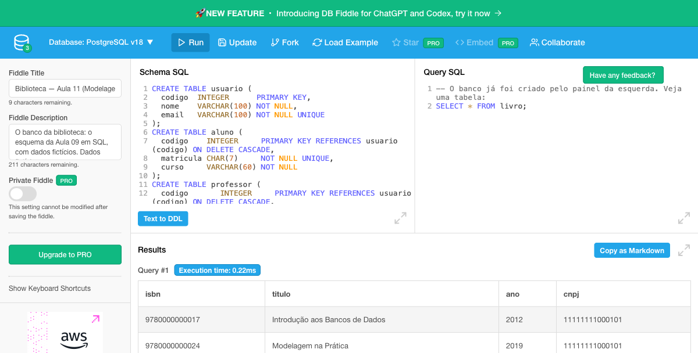

<!-- _class: capa -->

<div class="emoji">🏗️</div>

# Do Esquema ao PostgreSQL

## Aula 11 · Bloco 3 — Do Modelo ao Banco

<div class="meta">O que foi decidido no papel, o banco passa a cobrar</div>

---

## 🎯 Nesta aula

1. Do **modelo físico** ao **SQL**
2. **`CREATE TABLE`**: a tabela, as colunas e os tipos
3. As chaves: **`PRIMARY KEY`** e **`UNIQUE`**
4. **`NOT NULL`** e a **chave estrangeira**
5. O esquema da biblioteca, **inteiro em SQL**
6. **`INSERT`** — e o banco que recusa

---

<!-- _class: diagrama -->

## O esquema conferido vira banco


A Aula 09 completou a conversão; a Aula 10 conferiu o esquema. Hoje ele atravessa a última etapa — e **não é preciso instalar nada**.

---

<!-- _class: diagrama -->

## A última etapa: o modelo físico


Os três modelos da **Aula 05**. O curso inteiro trabalhou nos dois primeiros; o **físico** é o esquema escrito para um SGBD específico — aqui, o PostgreSQL.

---

## SQL: a língua dos bancos relacionais

O **SQL** nasceu na **IBM em 1974**, com o nome SEQUEL, criado por **Donald Chamberlin** e **Raymond Boyce** sobre o modelo relacional de **Codd** — o da Aula 02.

Virou **padrão oficial** em 1986, nos Estados Unidos, e em 1987 no mundo.

É por isso que, com pequenas diferenças, ele é **o mesmo em todo banco relacional**.

---

## Dois grupos de comandos — o curso usa o começo de cada um

| Grupo | Para quê | Aula 11 | Aula 12 |
|---|---|---|---|
| **Definição** dos dados (DDL) | criar a estrutura: tabelas, colunas, chaves | `CREATE TABLE` | — |
| **Manipulação** dos dados (DML) | pôr, ler, mudar e tirar dados | `INSERT` | `SELECT` |

**Definição** mexe na **forma**; **manipulação** mexe no **conteúdo**.

---

## PostgreSQL

Nasceu em **1986**, na Universidade da Califórnia em **Berkeley**, num projeto liderado por **Michael Stonebraker**.

Ganhou o SQL em **1994** e o nome atual em **1996**.

É **gratuito** e de **código aberto** — e, na pesquisa do Stack Overflow de 2025, foi o banco **mais usado** por desenvolvedores: **55,6%** dos que responderam.

---

<!-- _class: lead -->

## 💡 A promessa da Aula 05: independência de dados

O mesmo esquema lógico rodaria no MySQL
trocando **quase só os nomes de alguns tipos**.

Quem consulta o banco **não sabe** como
o PostgreSQL guarda os arquivos no disco.

Cada nível muda **sem obrigar o de cima** a mudar.

---

<!-- _class: diagrama -->

## Onde o banco roda: o DB Fiddle



À esquerda, os comandos que **criam** o banco; à direita, as **consultas**; **Run** executa tudo. Escolha **PostgreSQL v18**. Reserva: o **REPL do PGlite**, que roda no próprio navegador.

---

## `CREATE TABLE`: a tabela e as colunas

O esquema lógico dizia `EDITORA(cnpj, nome, rua, numero, cidade)`. Em SQL:

```sql
CREATE TABLE editora (
  cnpj   CHAR(14)     PRIMARY KEY,   -- a chave primária
  nome   VARCHAR(100) NOT NULL,      -- obrigatório
  rua    VARCHAR(100),               -- o endereço composto:
  numero VARCHAR(10),                --   uma coluna por parte
  cidade VARCHAR(60)
);
```

Nomes em **minúsculas**, com `_`; palavras do SQL em **maiúsculas**, só para facilitar a leitura.

---

<!-- _class: tabela-densa -->

## Cada coluna tem um tipo — o domínio da Aula 07

| Tipo | Guarda | Na biblioteca |
|---|---|---|
| `INTEGER` | número inteiro | `codigo` do usuário, `ano` do livro |
| `NUMERIC(p, s)` | número com casas decimais | o valor de uma multa: `NUMERIC(6, 2)` |
| `CHAR(n)` | texto de tamanho **fixo** | `cnpj` — sempre 14 caracteres |
| `VARCHAR(n)` | texto de tamanho **variável**, até `n` | `nome`, `titulo` |
| `DATE` | uma data | `data_retirada` |
| `BOOLEAN` | verdadeiro ou falso | se a sala tem quadro branco |

---

## ⚠️ Nem todo número é número

O **ISBN**, o **CNPJ** e o **CPF** são feitos de dígitos — mas **ninguém soma dois ISBNs**.

E um CPF que começa com zero **perderia o zero** numa coluna `INTEGER`.

**Se não se faz conta com ele, é texto:** `CHAR(13)` para o ISBN, `CHAR(14)` para o CNPJ, `CHAR(11)` para o CPF.

---

## `CHECK`: quando o tipo não basta

`INTEGER` aceita o ano 3000; `VARCHAR(20)` aceita a situação `'sumido'`. A regra de domínio da Aula 07 ganha nome:

```sql
ano      INTEGER CHECK (ano BETWEEN 1450 AND 2100),
situacao VARCHAR(20) NOT NULL
         CHECK (situacao IN ('disponivel', 'emprestado',
                             'em reparo', 'descartado'))
```

> 💡 A ausência de `NOT NULL` **também é uma decisão**: a coluna aceita vazio.

---

## `PRIMARY KEY`: simples ou composta

De **uma** coluna, vai ao lado dela. **Composta**, vai numa linha à parte, no fim:

```sql
CREATE TABLE exemplar (                  -- a entidade fraca da Aula 06
  isbn      CHAR(13) REFERENCES livro (isbn) ON DELETE CASCADE,
  numero_ex INTEGER,
  situacao  VARCHAR(20) NOT NULL,
  PRIMARY KEY (isbn, numero_ex)          -- a chave da dona + o discriminador
);
```

Declarar `PRIMARY KEY` já garante a **integridade de entidade**: sem vazio e sem repetição.

---

## `UNIQUE`: as chaves alternativas

As candidatas que **não** foram escolhidas como primária continuam únicas:

```sql
CREATE TABLE aluno (
  codigo    INTEGER     PRIMARY KEY REFERENCES usuario (codigo) ON DELETE CASCADE,
  matricula CHAR(7)     NOT NULL UNIQUE,   -- chave alternativa
  curso     VARCHAR(60) NOT NULL
);
```

A `matricula` é única, mas **não é ela** que as outras tabelas copiam. E o `nome` não leva `UNIQUE`: duas Anas Souza são o mundo, não um erro.

---

## A seta `→` vira `REFERENCES`

A coluna só aceita valores que **existem** na chave da outra tabela — a **integridade referencial** da Aula 07, declarada:

```sql
CREATE TABLE livro (
  isbn   CHAR(13)     PRIMARY KEY,
  titulo VARCHAR(200) NOT NULL,
  ano    INTEGER      CHECK (ano BETWEEN 1450 AND 2100),
  cnpj   CHAR(14)     NOT NULL REFERENCES editora (cnpj) ON DELETE RESTRICT
);
```

---

<!-- _class: diagrama -->

## Cada pedaço da última linha é uma decisão



Nada ali é novo: são três decisões de aulas anteriores, escritas para o banco **cobrar**.

---

## As três políticas de exclusão, em SQL

| Política (Aula 07) | Em SQL | Na biblioteca |
|---|---|---|
| **recusar** | `ON DELETE RESTRICT` | apagar uma editora que tem livros |
| **propagar** | `ON DELETE CASCADE` | apagar um livro apaga os exemplares |
| **anular** | `ON DELETE SET NULL` | a ligação é opcional; a linha sobrevive |

> ⚠️ Participação total pede **recusar** ou **propagar** — nunca anular: a coluna é `NOT NULL`.

---

## Chave composta se propaga

Quando a chave apontada é **composta**, a estrangeira também é — numa linha à parte:

```sql
CREATE TABLE emprestimo (
  numero         INTEGER  PRIMARY KEY,
  data_retirada  DATE     NOT NULL,
  data_devolucao DATE,                    -- vazia: empréstimo em aberto
  codigo_usuario INTEGER  NOT NULL REFERENCES usuario (codigo) ON DELETE RESTRICT,
  isbn           CHAR(13) NOT NULL,
  numero_ex      INTEGER  NOT NULL,
  FOREIGN KEY (isbn, numero_ex) REFERENCES exemplar (isbn, numero_ex) ON DELETE RESTRICT
);
```

---

<!-- _class: diagrama -->

## ⚠️ A ordem de criação importa


Criar `livro` antes de `editora` dá *`relation "editora" does not exist`*. Primeiro as tabelas **apontadas**, depois as que **apontam**.

---

<!-- _class: tabela-densa -->

## O dicionário da tradução

| No esquema lógico | No SQL |
|---|---|
| a chave primária | `PRIMARY KEY` — numa linha à parte, se for composta |
| a chave alternativa | `UNIQUE` |
| a seta `→` | `REFERENCES tabela (coluna)` — ou `FOREIGN KEY (…) REFERENCES` |
| a participação total | `NOT NULL` na chave estrangeira |
| o domínio | o tipo da coluna, mais `CHECK` quando o tipo não basta |
| a política de exclusão | `ON DELETE RESTRICT`, `CASCADE` ou `SET NULL` |

O script completo, com os dados fictícios, está em **`exemplos/biblioteca.sql`** — e no link da aula.

---

## `INSERT`: os dados entram

```sql
INSERT INTO editora VALUES
  ('11111111000101', 'Editora Aurora', 'Rua das Flores', '100', 'Porto Alegre');

INSERT INTO usuario (codigo, nome, email)      -- nomeando as colunas
VALUES (1, 'Ana Souza', 'ana@aluno.br');
```

Os valores vêm **na ordem das colunas** — ou na ordem de uma lista dada logo depois do nome da tabela, a forma mais segura.

Texto e data entre **aspas simples**; número, sem aspas; `NULL` é o vazio.

---

<!-- _class: tabela-densa -->

## O banco que recusa — seis tentativas no PostgreSQL 18

| Tentativa | Resultado | A regra que agiu |
|---|---|---|
| editora com um CNPJ que já existe | recusada | integridade de **entidade** — `PRIMARY KEY` |
| livro com o CNPJ de uma editora que não existe | recusada | integridade **referencial** — `REFERENCES` |
| usuário sem nome | recusada | o dado obrigatório — `NOT NULL` |
| exemplar com situação `'sumido'` | recusada | integridade de **domínio** — `CHECK` |
| apagar uma editora que tem livros | recusada | a política **recusar** — `RESTRICT` |
| empréstimo com `data_devolucao` vazia | **aceita** | nenhuma: é empréstimo em aberto |

---

## 💡 A mensagem diz o nome da regra

```
duplicate key value violates unique constraint "editora_pkey"

insert or update on table "livro" violates
foreign key constraint "livro_cnpj_fkey"
```

`editora_pkey` é a chave primária de `editora`; `livro_cnpj_fkey`, a chave estrangeira da coluna `cnpj` de `livro`.

**Ler a mensagem é achar a linha do `CREATE TABLE` que recusou** — e, por trás dela, a decisão de modelagem.

---

<!-- _class: lead -->

## Integridade não é recusar o que parece estranho

O empréstimo sem devolução **foi aceito** —
e está certo: é um empréstimo em aberto.

Vazio só é erro
**onde você declarou `NOT NULL`**.

---

<!-- _class: checkpoint -->

## 🏋️ Exercícios da aula

Na pasta `aula-11/` — o SQL escrito no `.md`, comentado; rodar no link é opcional:

1. **`ex01.md`** — o `CREATE TABLE` das **salas** e das **reservas**: chave composta e duas políticas diferentes;
2. **`ex02.md`** — a especialização dos **espaços**, na estratégia B;
3. **`ex03.md`** — seis comandos: **aceito ou recusado**, e por qual regra?

---

<!-- _class: lead -->

## ➡️ Próxima aula

**Aula 12 — Consultas básicas em SQL**

O banco existe, com dados dentro.
Agora ele começa a **responder perguntas**.
