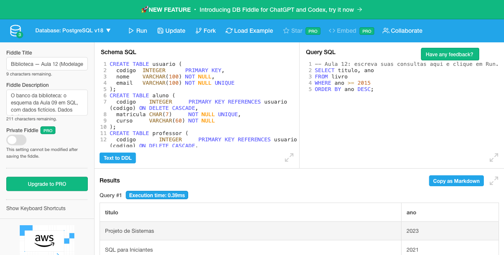

<!-- _class: capa -->

<div class="emoji">🔎</div>

# Consultas Básicas em SQL

## Aula 12 · Bloco 3 — Do Modelo ao Banco

<div class="meta">Cada pergunta do balcão vira um comando</div>

---

## 🎯 Nesta aula

1. **`SELECT`**: as colunas que a resposta mostra
2. **`WHERE`**: as linhas que interessam — e o vazio
3. **`ORDER BY`** e **`LIMIT`**: a ordem da resposta
4. A primeira junção: **`JOIN … ON`**
5. **Três tabelas**: seguindo as setas
6. Da **pergunta do balcão** à consulta

---

<!-- _class: diagrama -->

## Ontem o banco aprendeu a dizer não


Hoje ele aprende a **responder**. Não há tabela nova nem regra nova: as chaves estrangeiras desenhadas desde a Aula 07 passam a servir de **caminho**.

---

<!-- _class: diagrama -->

## O banco da aula, com dados



O banco da Aula 11 já está criado no painel da esquerda. As consultas vão no painel da **direita**; **Run** executa e mostra a resposta embaixo.

---

## `SELECT`: a consulta mais simples

```sql
SELECT * FROM editora;
```

| cnpj | nome | rua | numero | cidade |
|---|---|---|---|---|
| 11111111000101 | Editora Aurora | Rua das Flores | 100 | Porto Alegre |
| 22222222000102 | Editora Vértice | Av. Central | 2500 | São Paulo |
| 33333333000103 | Editora Ponte Alta | | | Curitiba |

Lê-se: *"selecione **tudo** (`*`) da tabela `editora`"*.

---

## Só as colunas que a pergunta quer

```sql
SELECT titulo, ano
FROM livro;
```

As **seis** linhas de `livro`, mas só as **duas** colunas pedidas, na ordem pedida. A consulta só **lê**: a tabela continua inteira no banco.

> 💡 **A resposta também é uma tabela** — com colunas e linhas. É a ideia de Codd da Aula 02: tudo é tabela, inclusive a resposta.

---

## `WHERE`: as linhas que interessam

O `SELECT` escolhe as **colunas**; o `WHERE` escolhe as **linhas**.

```sql
SELECT titulo, ano
FROM livro
WHERE ano >= 2015;
```

Quatro dos seis livros passam: *Modelagem na Prática* (2019), *SQL para Iniciantes* (2021), *História da Computação* (2016) e *Projeto de Sistemas* (2023).

---

<!-- _class: tabela-densa -->

## As peças de uma condição

| Peça | Significa | Exemplo |
|---|---|---|
| `=` `<>` `<` `<=` `>` `>=` | comparar número, data ou texto | `ano >= 2015` |
| `AND` · `OR` | as duas · pelo menos uma | `ano >= 2015 AND ano < 2020` |
| `IN (…)` | um dos valores da lista | `situacao IN ('em reparo', 'descartado')` |
| `LIKE` | um padrão; `%` é "qualquer coisa" | `email LIKE '%@aluno.br'` |
| `IS NULL` · `IS NOT NULL` | vazio · preenchido | `data_devolucao IS NULL` |

Texto e data entre **aspas simples** — e o texto compara letra por letra: `'ana souza'` não encontra `'Ana Souza'`.

---

## O vazio tem um teste próprio

Os empréstimos em aberto são os que ainda não têm data de devolução:

```sql
SELECT numero FROM emprestimo WHERE data_devolucao = NULL;    -- 0 linhas

SELECT numero FROM emprestimo WHERE data_devolucao IS NULL;   -- 4 linhas
```

`NULL` não é um valor: é a **ausência** de valor. Comparar com `NULL` usando `=` **nunca** dá verdadeiro — nem quando a coluna também está vazia.

---

<!-- _class: lead -->

## ⚠️ O `= NULL` não dá erro — e é por isso que é perigoso

O banco executa, devolve **zero linhas**,
e quem lê conclui:
*"não há empréstimo em aberto"*.

A resposta errada **parece uma resposta**.

Envolveu vazio? **`IS NULL`** ou **`IS NOT NULL`**.

---

<!-- _class: tabela-densa -->

## `ORDER BY`: a ordem se pede

Sem pedido, o banco devolve as linhas **na ordem que for conveniente para ele** — e ela pode mudar.

```sql
SELECT titulo, ano FROM livro
WHERE ano >= 2015
ORDER BY ano DESC;
```

| titulo | ano |
|---|---|
| Projeto de Sistemas | 2023 |
| SQL para Iniciantes | 2021 |
| Modelagem na Prática | 2019 |
| História da Computação | 2016 |

---

## `LIMIT`: quantas linhas, no máximo

`DESC` é decrescente; sem ele, a ordem é **crescente** — do menor número, da data mais antiga, do começo do alfabeto.

O `LIMIT` corta **depois** de ordenar. Os três livros mais antigos do acervo:

```sql
SELECT titulo, ano
FROM livro
ORDER BY ano
LIMIT 3;
```

*Algoritmos em Português* (2008), *Introdução aos Bancos de Dados* (2012), *História da Computação* (2016).

---

<!-- _class: diagrama -->

## A ordem das cláusulas é a ordem da pergunta


A ordem é **fixa**. E cada cláusula só entra quando a pergunta pede: sem filtro, não há `WHERE`; sem ordem pedida, não há `ORDER BY`.

---

## Qual é a editora de cada livro?

A normalização da Aula 10 tirou o nome da editora de `livro`: lá está só o **`cnpj`**, a chave estrangeira. O nome mora em `editora`.

Para responder, é preciso **juntar** as duas tabelas:

```sql
SELECT livro.titulo, editora.nome
FROM livro
JOIN editora ON livro.cnpj = editora.cnpj;
```

O **`JOIN`** põe lado a lado uma linha de cada tabela; o **`ON`** diz **qual com qual**.

---

<!-- _class: diagrama -->

## O `ON` casa cada livro com a sua editora



As que têm **o mesmo CNPJ** — a seta `cnpj → EDITORA` do esquema lógico. **Seis livros, seis linhas**: juntar pela coluna em comum devolve o que a planilha tinha numa linha só.

---

## Apelidos — e a coluna ambígua

As duas tabelas têm `cnpj` e `nome`. Escrever só `cnpj = cnpj` é recusado:

```
column reference "cnpj" is ambiguous
```

Para não repetir o nome inteiro, cada tabela ganha um **apelido** no `FROM`:

```sql
SELECT l.titulo, ed.nome
FROM livro l
JOIN editora ed ON l.cnpj = ed.cnpj
WHERE ed.cidade = 'Curitiba';
```

---

<!-- _class: diagrama -->

## ⚠️ Junção sem condição multiplica



`FROM livro, editora` **sem** a condição combina cada livro com **cada** editora: 6 × 3 = **18 linhas**, e 12 delas mentem. É o **produto cartesiano** — o sintoma é sempre linhas demais, repetidas.

---

## Três tabelas: quem está com livro agora?

O empréstimo está em `emprestimo`; o nome, em `usuario`; o título, em `livro`. Cada `JOIN` a mais segue **mais uma seta**:

```sql
SELECT u.nome, l.titulo, em.data_retirada
FROM emprestimo em
JOIN usuario u ON em.codigo_usuario = u.codigo
JOIN livro   l ON em.isbn = l.isbn
WHERE em.data_devolucao IS NULL
ORDER BY em.data_retirada;
```

Quatro linhas: **Ana**, **Carlos**, **Carla** e **Eduardo**.

---

<!-- _class: diagrama -->

## O atalho pelo `isbn`



A chave estrangeira de `emprestimo` aponta para `exemplar`. Mas o `isbn` do empréstimo **é** o do livro — a chave da dona, propagada pela entidade fraca. A consulta pode **pular** `exemplar`.

---

<!-- _class: diagrama -->

## No N:M, não há atalho


Entre `livro` e `autor` não existe seta: o N:M virou `escreve` na Aula 07, e a consulta **tem de passar por ela**. Título e sobrenome de cada autoria: **8 linhas**, uma por linha de `escreve`.

---

## Da pergunta do balcão à consulta

Hoje é **1º de dezembro de 2026**, e a bibliotecária pergunta:

> *"Quem está com livro atrasado, e qual livro? Quero mandar um e-mail para cada um."*

O prazo de empréstimo é de **14 dias**.

Toda consulta desta aula se monta com **as mesmas quatro perguntas**.

---

<!-- _class: tabela-densa -->

## As quatro perguntas, e a cláusula de cada uma

| Pergunta | Na biblioteca | Cláusula |
|---|---|---|
| **1.** O que a resposta mostra? | nome, e-mail, título — e a data, para conferir | `SELECT` |
| **2.** Em que tabelas isso mora? | `usuario`, `livro`, `emprestimo` — e as setas que as ligam | `FROM`, `JOIN … ON` |
| **3.** Que linhas interessam? | não devolvido **e** retirado antes de 17/11 | `WHERE` |
| **4.** Em que ordem? | o atraso mais antigo primeiro | `ORDER BY` |

---

<!-- _class: tabela-densa -->

## A consulta, e a resposta

```sql
SELECT u.nome, u.email, l.titulo, em.data_retirada
FROM emprestimo em
JOIN usuario u ON em.codigo_usuario = u.codigo
JOIN livro   l ON em.isbn = l.isbn
WHERE em.data_devolucao IS NULL
  AND em.data_retirada < '2026-11-17'
ORDER BY em.data_retirada;
```

| nome | email | titulo | data_retirada |
|---|---|---|---|
| Ana Souza | `ana@aluno.br` | Introdução aos Bancos de Dados | 2026-10-20 |
| Carlos Mendes | `carlos@prof.br` | SQL para Iniciantes | 2026-11-05 |

---

## 💡 Num sistema de verdade, a data não fica escrita

O PostgreSQL sabe a data de hoje — **`CURRENT_DATE`** — e sabe fazer conta com datas:

```sql
WHERE em.data_devolucao IS NULL
  AND em.data_retirada < CURRENT_DATE - 14
```

Aqui ela fica fixa para que o resultado seja **o mesmo para todo mundo**, em qualquer dia em que a consulta for rodada.

---

<!-- _class: lead -->

## Cada pedaço da consulta saiu do papel

O **`JOIN`** segue uma seta da **Aula 07**.

O **`IS NULL`** respeita o vazio
que a Aula 07 ensinou a não tratar como erro.

O nome num lugar só
é a **normalização** da Aula 10.

---

## 📖 Daqui para a frente

Contar e agrupar (**`COUNT`**, **`GROUP BY`**), consultas dentro de consultas, mudar e apagar dados, transações: é o caminho de um **curso de SQL**.

A **documentação do PostgreSQL** tem um tutorial que repassa o que o curso viu e segue adiante — e o DB Fiddle continua aberto para experimentar.

---

<!-- _class: checkpoint -->

## 🏋️ Exercícios da aula

Na pasta `aula-12/` — cada consulta comentada; rodar no link é opcional:

1. **`ex01.md`** — quatro consultas sobre **uma tabela**: filtro, vazio, ordem e limite;
2. **`ex02.md`** — três consultas sobre **duas tabelas**: editora, exemplares e alunos;
3. **`ex03.md`** — do **balcão** à consulta, e de volta: as oficinas sem passar por `professor`.

---

<!-- _class: lead -->

## 🏁 Da planilha ao banco

A Aula 01 começou com uma planilha
**que se contradizia**.

O curso termina com um banco que **recusa**
o que contradiz as regras do minimundo —
e **responde** ao que se pergunta a ele.
