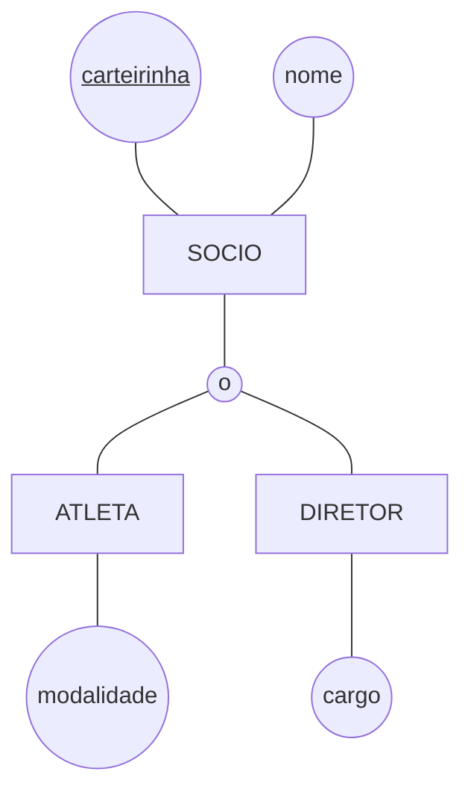

# Revisão geral — Aulas 07 a 11

### R-01

A tabela de retiradas que a Aula 10 (Normalização Essencial) normaliza veio de uma planilha importada sem revisão, e trouxe de volta os problemas da Aula 01 (A Redundância e a Resposta do SGBD). Segundo as duas aulas, o que a normalização elimina são:

- **a)** as falhas de energia no meio de uma gravação, que deixam meia operação no banco;
- **b)** os acessos simultâneos de dois usuários ao mesmo registro;
- **c)** as anomalias de inserção, de alteração e de exclusão, que aparecem quando uma tabela guarda fatos de assuntos diferentes;
- **d)** os erros de digitação, porque cada valor passa a ser conferido pelo banco.

↩︎ *Aula 01, seção 3 — As três anomalias · Aula 10, seção 1 — A planilha volta, disfarçada de tabela*

---

### R-02

Uma floricultura cadastra os clientes. De cada um interessam o CPF, o nome, o endereço de entrega — rua, número e bairro — e os telefones, que podem ser vários. Segundo as Aulas 03 (Os Elementos de um Banco de Dados) e 09 (Especialização e o Esquema Completo):

- **a)** o endereço é composto e vira três colunas em `CLIENTE`; os telefones são multivalorados e viram a tabela `CLIENTE_TELEFONE(cpf → CLIENTE, telefone)`;
- **b)** o endereço é multivalorado e vira uma tabela própria; os telefones são compostos e viram as colunas `telefone1`, `telefone2` e `telefone3`;
- **c)** o endereço é composto e vira uma tabela própria; os telefones são multivalorados e viram uma coluna só, com a lista separada por vírgula;
- **d)** os dois são atributos simples, e cada um vira uma coluna em `CLIENTE`.

↩︎ *Aula 03, seção 3 — Atributo e seus tipos · Aula 09, seção 4 — Atributo composto e multivalorado: o que a Aula 07 não converteu*

---

### R-03

Um estacionamento cadastra os mensalistas com quatro colunas: o `codigo`, um número curto que o estacionamento atribui e que nunca muda; o `cpf`; a `placa` do carro, que muda quando o mensalista troca de carro; e o `nome`. Segundo a Aula 07 (Do Relacional à Integridade Referencial), a melhor chave primária é:

- **a)** a `placa`, porque é por ela que o atendente reconhece o mensalista na entrada;
- **b)** o par `(cpf, nome)`, porque juntos eles descrevem melhor o mensalista;
- **c)** o `nome`, porque é o único dado que todo mensalista com certeza tem;
- **d)** o `codigo`, porque nunca muda, é o menor e nunca fica vazio.

↩︎ *Aula 07, seção 2 — Chaves: o que identifica uma tupla*

---

### R-04

Num teatro, cada `ESPETACULO` tem várias `APRESENTACAO`, numeradas de 1 em diante dentro do próprio espetáculo: a apresentação é entidade fraca. Um espetáculo cadastrado por engano, ainda sem ingresso vendido, vai ser apagado. Segundo a Aula 07 (Do Relacional à Integridade Referencial), a política para as apresentações dele é:

- **a)** anular: as apresentações ficam no cadastro, sem espetáculo;
- **b)** propagar: a apresentação não existe sem o espetáculo, então sai junto com ele;
- **c)** recusar: nenhuma linha pode ser apagada enquanto houver outra apontando para ela;
- **d)** nenhuma: o banco apaga o espetáculo e deixa as apresentações como estão.

↩︎ *Aula 07, seção 5 — E quando alguém apaga o outro lado?*

---

### R-05

Num festival, as bandas se apresentam nos palcos: um N:M entre `BANDA` e `PALCO`, o `APRESENTA`, com o horário no losango. A produção quer registrar os técnicos de som escalados para cada apresentação, e o mesmo técnico trabalha em várias apresentações ao longo do festival. Segundo a Aula 08 (Agregação e Estudo de Caso), o técnico se liga:

- **a)** ao encontro da banda com o palco, aquela apresentação, e por isso o `APRESENTA` vira uma agregação;
- **b)** à `BANDA`, porque é a banda que precisa do som;
- **c)** ao `PALCO`, porque a mesa de som fica no palco;
- **d)** a nada: o técnico é um atributo do losango, como o horário.

↩︎ *Aula 08, seções 1 e 2 — O relacionamento que precisa se relacionar; Agregação: tratar um relacionamento como uma coisa*

---

### R-06

No festival da R-05, a escala dos técnicos vira uma tabela que aponta para a apresentação inteira — a banda **e** o palco juntos, com uma chave estrangeira de duas colunas. Um colega propôs trocar isso por duas chaves estrangeiras independentes, uma para `BANDA` e outra para `PALCO`. Segundo a Aula 08 (Agregação e Estudo de Caso), o esquema do colega passaria a aceitar:

- **a)** nada de diferente: as duas formas guardam exatamente as mesmas escalas;
- **b)** dois técnicos na mesma apresentação, o que a forma original proibia;
- **c)** um técnico escalado para a banda X no palco 2 sem que a banda X toque no palco 2;
- **d)** uma apresentação sem técnico nenhum, o que a forma original proibia.

↩︎ *Aula 08, seção 3 — A alternativa: promover o relacionamento a entidade*

---

### R-07

O diagrama abaixo é de um clube:



O que ele afirma sobre os sócios?

- **a)** todo sócio é atleta ou diretor, e ninguém é os dois;
- **b)** pode haver sócio que não é atleta nem diretor, e um sócio pode ser os dois ao mesmo tempo;
- **c)** pode haver sócio que não é nenhum dos dois, mas quem é atleta não pode ser diretor;
- **d)** todo sócio é pelo menos um dos dois, e pode ser os dois.

↩︎ *Aula 09, seção 2 — As duas perguntas que toda especialização responde*

---

### R-08

Uma livraria quer dividir `CLIENTE` em `CLIENTE_COMUM` e `CLIENTE_FIDELIDADE`. O cliente entra no programa de fidelidade quando quer e pode sair dele, e o cadastro guarda as mesmas informações nos dois casos. Segundo a Aula 09 (Especialização e o Esquema Completo):

- **a)** é uma boa especialização, total e disjunta, porque todo cliente está em um dos dois tipos;
- **b)** é uma especialização sobreposta, porque o mesmo cliente pode passar pelos dois tipos;
- **c)** são duas entidades separadas, sem superclasse, porque os dois tipos nunca se misturam;
- **d)** não deve virar especialização: o cliente entra e sai do programa, e nenhum dos dois tipos tem dado só seu — basta um atributo em `CLIENTE` dizendo se ele participa.

↩︎ *Aula 09, seção 3 — Quando não especializar*

---

### R-09

Um cineclube descreve o acervo assim: *"cada filme tem um código, um título e um diretor; cada diretor tem um código e um nome; um diretor dirige vários filmes; dois filmes podem ter o mesmo título, e dois diretores podem ter o mesmo nome"*. Segundo a Aula 10 (Normalização Essencial), qual destas dependências funcionais vale?

- **a)** `codigo_filme → codigo_diretor`
- **b)** `titulo → codigo_filme`
- **c)** `codigo_diretor → codigo_filme`
- **d)** `nome_diretor → codigo_diretor`

↩︎ *Aula 10, seção 2 — Dependência funcional: "se eu sei isto, eu sei aquilo"*

---

### R-10

A tabela `ITEM_PEDIDO(numero_pedido, codigo_produto, quantidade, nome_produto)` tem chave `(numero_pedido, codigo_produto)`, e cada produto tem um nome. Segundo a Aula 10 (Normalização Essencial), o `nome_produto`:

- **a)** depende da chave inteira e já está no lugar certo;
- **b)** depende só de parte da chave: é uma dependência parcial, que impede a 2FN;
- **c)** depende de uma coluna que não é chave: é uma dependência transitiva, que impede a 3FN;
- **d)** guarda uma lista de valores, o que viola a 1FN.

↩︎ *Aula 10, seção 4 — A segunda forma normal: nada depende de parte da chave*

---

### R-11

As duas tabelas abaixo são de um cinema:

```sql
CREATE TABLE filme (
  codigo INTEGER      PRIMARY KEY,
  titulo VARCHAR(100) NOT NULL
);
CREATE TABLE sessao (
  numero       INTEGER PRIMARY KEY,
  data         DATE    NOT NULL,
  codigo_filme INTEGER NOT NULL REFERENCES filme (codigo) ON DELETE RESTRICT
);
```

Segundo a Aula 11 (Do Esquema ao PostgreSQL), o `NOT NULL` da coluna `codigo_filme` traduz:

- **a)** a cardinalidade 1:N, que põe a chave estrangeira do lado N;
- **b)** a política de exclusão escolhida na Aula 07 (Do Relacional à Integridade Referencial);
- **c)** a participação total desenhada no DER: toda sessão tem um filme;
- **d)** a integridade de entidade, que impede a chave primária de ficar vazia.

↩︎ *Aula 11, seções 4 e 5 — `NOT NULL` e a chave estrangeira; O esquema da biblioteca, inteiro em SQL*

---

### R-12

No cinema da R-11, alguém rodou:

```sql
INSERT INTO sessao VALUES (31, '2026-11-24', 99);
```

O PostgreSQL respondeu `insert or update on table "sessao" violates foreign key constraint "sessao_codigo_filme_fkey"`. Segundo a Aula 11 (Do Esquema ao PostgreSQL), isso quer dizer que:

- **a)** já existe uma sessão com o número 31;
- **b)** a data não está no formato que a coluna aceita;
- **c)** a coluna `codigo_filme` não aceita ficar vazia;
- **d)** não existe filme com o código 99, e a integridade referencial recusou a linha.

↩︎ *Aula 11, seção 6 — `INSERT`, e o banco que recusa*

---

⬅️ [Voltar ao plano de aulas](../README.md)
